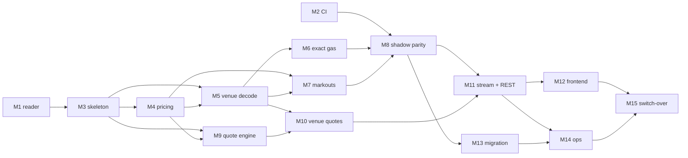

# mpamm.wtf rebuild — implementation plan

How the rebuild in [rebuild-spec.md](rebuild-spec.md) gets built: milestones in order,
the tasks in each, what "done" means, and what waits on DevOps. The spec says *what*
and *why*; this file says *how* and *in what order*. Tick a box when its work is on
`v2` (PR #176); a milestone is done only when its **Done when** checks pass.

Status as of 2026-11-27 (evening): M1's 7-day gate run is under way on the node host
(started 07:17 UTC, by hand until the unit edit lands). M2–M4 and M6 are in place; M5 has
5 of 9 decoding venues ported and identical to today's on real blocks (the other 4 are
being ported); M7's markouts, curves and analytics, M9's engine and M13's migration tool
are built; M10 and M11 are under way.

**The node keeps about 17 hours of history** (it served blocks from 125,604,242 when the
head was 125,811,220). Repairs beyond that, a catch-up after a long outage, and history
replays all need the hosted archive: the env file with its URL is now on the critical
path for M8.

## Ground rules

- **One branch, one PR.** All rebuild work lands on `v2` and in PR #176, which merges
  into `main` only after M15. Today's system on `main` keeps serving until then.
- **The repo is public.** No host names, IPs, RPC URLs, keys or internal node names in
  code, commits, docs or the PR.
- **Correctness first.** Every item in the spec's *Correctness requirements* must hold.
  Today's system is the reference: phase gates compare against it, never against our
  own expectations.
- **Built off the node host.** Release builds come from CI (or `service/scripts/build-linux.sh`
  until CI exists), never from compiling on the host.
- **SDK pinned to the node.** `monad-event-ring` / `monad-exec-events` use the node's
  release tag. A node upgrade means a rebuild against the new tag, shipped together.
- **Measure, then claim.** Every latency or parity statement in a commit or the PR is
  backed by a run on the host or a recorded fixture.

## Milestones at a glance

| # | Milestone | Phase | Depends on | Waits on DevOps for | Status |
| --- | --- | --- | --- | --- | --- |
| M1 | Reader hardening and the 7-day gate run | 1 | — | one edit to `mpamm.service` (gate run only) | Gate run under way |
| M2 | CI, release artifacts, deploy script | 1 | — | registry credentials (publishing only); the unit edit (deploy rehearsal) | In progress |
| M3 | Service skeleton: crates, config, store, commit pipeline, registry | 2 | M1 | — | Done (types' TS export moves to M11) |
| M4 | Pricing: exchange feeds, references, late-decode pricing | 2 | M3 | — | Done (archives → M7; USD parity checked in M8) |
| M5 | Venue discovery and decode ports (11 venues) | 2 | M3, M4 | archive RPC URLs (backfill) | All 11 ported; verify-venue and adapters.md left |
| M6 | Exact gas and attribution | 2 | M5 | — | Built; 3-day recount pending |
| M7 | Markouts and analytics | 2 | M4, M5 | — | Built; archives pending |
| M8 | Shadow run and daily parity (phase-2 gate) | 2 | M5–M7 | env file | Shadow run with all 11 venues under way; parity hourly |
| M9 | Quote engine | 3 | M3, M4 | — | Built, with depth curves |
| M10 | Venue quote ports and same-block parity (phase-3 gate) | 3 | M5, M9 | CPU set | 9 of 11 quote ports done |
| M11 | Stream and REST | 4 | M8, M10 | — | Today's REST and v2 stream ported; compact protocol left |
| M12 | Frontend on the new stream | 4 | M11 | — | Today's dashboard runs unchanged on the Rust API |
| M13 | Data migration and replication | 4 | M8 | object storage bucket | Migration tool built |
| M14 | Operations readiness | 4 | M11, M13 | hot fallback WS, TLS hostname, on-call | Alerts, notes, runbooks written; fallback mode left |
| M15 | Switch-over and merge (phase-4 gate) | 4 | M12–M14 | DNS change | Not started |
| M16 | Edge relays (optional) | 5 | M15 | relay hosting | Only if chosen |
| M17 | In-process EVM (optional) | 6 | M10 | — | Only if needed |



M1's gate run, M2, M3–M7 and M9 can proceed in parallel once M3's skeleton exists.
The gates (M1, M8, M10, M15) take calendar time: start their runs as early as the
code allows.

## Target layout

```text
service/
  Cargo.toml            workspace; SDK pinned to the node tag
  reader/               mpamm-reader: phase-1 tool (stays as a diagnostics binary)
  crates/
    types/              shared types (Fill, QuoteRow, block refs), TS export via ts-rs
    registry/           tokens, assets, pairs, markets, sizes, references (data file loader)
    ring/               event-ring reader library: watch set, block assembly, gaps
    chain/              RPC clients: local node, hosted hot, archive; availability gate
    store/              SQLite schema, migrations, commit batches, revisions
    pricing/            exchange feeds, pair-terms reference, wrapper rates, late pricing
    venues/             Venue trait + one module per venue (+ generations)
    pipeline/           trades at Finalized: decode, price, attribute, gas, markouts
    quotes/             per-block quote jobs, deadlines, late rows, depth curves
    api/                stream (compact schema + dictionary) and REST (axum)
  mpamm/                the service binary: config, wiring, threads, health
  tools/                verify-venue, parity diffs, migration, benchmarks
  deploy/mpamm.toml     settings installed on the host (no secrets)
  scripts/              cargo-linux.sh, build-linux.sh, deploy.sh
shared/registry.json    the market registry (single source for service and web)
```

---

## Phase 1 — event feed

### M1 · Reader hardening and the 7-day gate run

**Goal:** the reader runs unattended for 7 days, loses nothing, and produces the
measurements the spec needs (proposal delay, execution time, commit timings, ring depth).

- [x] Read the ring with the SDK pinned to the node tag; assemble per-block timelines
- [x] Record arrival, execution, voted / finalized / verified times, abandoned proposals,
      gaps, expired payloads, reader lag, ring depth; per-proposer arrival
- [x] First live run on the host (60 s: 0 gaps, lag 0)
- [x] 1-hour run analysed (2026-11-27): 11,915 blocks, 22.1M events, 0 gaps, 0 expired
      payloads, 0 abandoned, reader lag ≤ 94 events. Arrival p50 47.7 ms / p90 113.5 ms
      (by proposer: Europe 37 ms, North America East 73 ms, West 95 ms, Asia-Pacific 122 ms);
      execution p50 7.0 ms / p99 22.7 ms; finalized +573 ms, verified +1,478 ms. Ring depth
      218–407 s as load ranged 4,600–12,800 events/s.
- [x] **Gap repair:** heights the ring can't deliver whole (sequence gap, expired
      payload, record error, lost finalization) are reported `Missing` in order by the
      ring crate's tracker and read over RPC, local node first, then the archive.
      On the host, an 8-minute forced pause lost 1,585 heights; all were repaired from
      the local node within seconds.
- [x] **Resume:** `cursor.json` holds the first height not yet written; a restart
      replays from the ring, or from its oldest block with the rest repaired. On the
      host: a restart after 2 minutes resumed with no repair and no duplicate; one
      after 7.5 minutes (cursor out of the ring) repaired the 194 heights in between.
- [x] **Shutdown:** SIGTERM/SIGINT write what is held, the cursor and a last health line
- [x] **Rotation:** daily `blocks-` and `summary-` files (UTC), `--keep-days` (30)
- [x] **Health:** `health.json` every second (status, lag, unrepaired heights)
- [x] **Core pinning:** `--cpu <n>` (or `cpu` in `/var/lib/mpamm/mpamm.toml`, for runs
      under the unit, which passes no arguments)
- [x] Ring adapter proven against the SDK's recorded ring (31 blocks, 8,582 logs: block
      hashes, transaction headers and every log's block-level index match)
- [ ] Run for 7 days: started 2026-11-27 07:17 UTC by hand (`nohup`, CPU 0, output in
      `/var/lib/mpamm/reader/`); moves to `mpamm.service` once the unit points at
      `/var/lib/mpamm/bin/mpamm` *(DevOps: the one unit edit in the tracker)*. A host
      reboot before then stops it; it resumes from its cursor when restarted.

**Done when:** 7 consecutive days with no unrepaired gap; ring depth, execution-time and
arrival distributions published in the PR; restart and repair paths exercised at least
once each on the host.

### M2 · CI, release artifacts, deploy script

- [x] GitHub Actions job (`.github/workflows/service.yml`): `cargo fmt --check`,
      `cargo clippy -D warnings`, `cargo test` for `service/` on Ubuntu 24.04 with
      clang-19, CMake, libhugetlbfs-dev, libzstd-dev
- [x] Cache the cargo registry and the Monad git checkout between runs
- [x] Release build for `x86-64-v3` as a workflow artifact named after the commit SHA
      and node tag (publishing to a registry waits for credentials)
- [x] `service/scripts/deploy.sh`: installs a build as `/var/lib/mpamm/bin/mpamm` with
      `service/deploy/mpamm.toml`, keeps the previous binary, restarts `mpamm.service`,
      checks health and puts the previous binary back on failure; `--rollback`
- [x] Ring-snapshot fixture tests: the SDK's own recorded ring replayed through the
      adapter and tracker (`crates/ring/tests/snapshot.rs`), no node needed
- [x] `service/scripts/cargo-linux.sh`: any cargo command for Linux in the build container
- [ ] Rehearse a deploy and a rollback with the script *(needs the unit edit)*

**Done when:** every push to `v2` runs the job green; a deploy and a rollback have been
done with the script.

---

## Phase 2 — trades, volume and gas (shadow)

### M3 · Service skeleton

- [x] Workspace crates per *Target layout* (plus `core`: the final-block shape and the
      venue trait shared by venues and the pipeline); `mpamm` binary with settings (flags,
      `[service]` in `mpamm.toml`, secrets from the environment), `tracing` logs, the
      spec's thread model (pinned ring reader, async runtime, one SQLite writer thread),
      `GET /api/health` on localhost, clean SIGTERM
- [x] `registry`: tokens, assets and pairs moved from computed TypeScript to
      `shared/registry.json` (byte-identical values; v1's tests unchanged), read by
      `shared/src/index.ts` and by `crates/registry`, whose lookups are tested against
      today's TypeScript answers (`tests/golden.json`, kept fresh by a server test)
- [x] `types`: Fill, QuoteRow, VenueMeta, daily volume and gas in today's JSON shapes
      (REST stays compatible); the new stream's message types and their TypeScript
      generation (ts-rs) land with them in M11
- [x] `ring`: the reader's logic as a library: watch set (logs by address+topic0,
      transaction headers, calldata by `to`), block assembly at `BLOCK_END`, block-level
      log index from `log_count` and `txn_count`, commit-state tracking, abandonment at
      finalization, lost finalizations recovered from parent hashes, `Missing` heights
- [x] `store`: new SQLite schema (trades kept forever, daily volume, daily gas marked
      exact / estimate / mixed, cursors, revisions, venue state, meta); one transaction per
      final block including the cursor, refusing anything but cursor + 1; volume grows
      only by trades actually inserted; a newer schema is refused, never wiped
- [x] `pipeline`: strict block-order commits at Finalized; a lost height is read over RPC
      (local node, then archive, one client per block) and holds later commits until it
      is; fail-closed on any read, decode or commit error
- [x] `chain`: JSON-RPC client (calls, batches, URL-free errors); pinned reads with
      explicit gas arrive with the quote engine (M9), the hosted hot client with fallback
      mode (M14)
- [ ] Revisions: dated, one-shot history repairs as data (`historyRevisions` /
      `gasRevisions` / `markets`); the table exists, the logic lands with the first venue
      that declares one (M5)

On the host (2026-11-27), with no venues: every final block committed from the ring at a
lag of 1–2 blocks, no holds; stopped by SIGTERM and restarted 30 s later, it resumed at
the cursor + 1 and caught up 159 blocks from the ring.

**Done when:** the binary runs on the host with an empty venue list, commits empty final
blocks in order with the cursor, survives a restart mid-stream without a gap, and the
registry and types round-trip into the web build.

### M4 · Pricing

- [x] Exchange feeds: Kraken WS v2 (book checksums on Kraken's exact decimal text,
      per-book repair and resubscribe, instrument and engine status), Bybit (MONUSDT
      book + crosses), Binance (data mirror); one connection loop with a 30 s silence
      watchdog; every mid of the last 3 hours kept per symbol with its time
- [x] Pair-terms reference (stable crosses, wrapped/native basis, USDT/USD crossing,
      share rates): all 86 pair mids and all 344 reference rows equal today's TypeScript
      for the same books (`tests/reference_parity.rs`)
- [x] ERC-4626 wrapper rates (wrapped xStocks), one batch on the local node every minute
- [x] Pricing a block as of its own proposal time: exchange history at that time, else
      chain prints (`fill-time-prices.ts`, median of an asset's newest stable-quoted
      trades) when nearer than now, else live
- [x] Market-hours handling: Kraken closures withhold the reference and keep the last
      good price for settled trades
- [ ] Archived exchange prices for closed days (`closed-day-prices.ts`, `history/cex.ts`):
      moved to M7, where markout onboarding needs the same archives
- [ ] Reference starvation notes: with the notes model in M14 (`/api/health` already
      reports each feed's age and how many pairs have a reference)

On the node host (2026-11-27): all three feeds live and all 86 of 86 pairs priced,
wrapped xStocks included.

**Done when:** for a recorded day, USD for every crypto-quoted fill matches today's
system within its documented tolerance (checked with M8's daily parity), and late-decode
prices beat today's on the 11-15 outlier cases.

### M5 · Venue discovery and decode ports

Port in order of volume. Each venue: discovery (merging), sources (watch set), decode,
generations, revisions, fixture tests (reuse `server/src/venues/__tests__/fixtures`;
record new ones where a venue has none), `verify-venue` run on the live node.

Proven with `mpamm-tools decode-range` against `server/scripts/decode-range.ts` over the
same blocks of the live chain (`service/tools/compare-fills.py`), plus every TS fixture
test ported:

- [x] Hanji (17 CLOBs, wrapped xStocks, FastLane quoters): ids and every field identical
      over 20,000 blocks but crypto-quoted USD (each tool priced at its own moment); a
      2,000-block range decoded by both at once is identical, USD included. The FastLane
      relay counts only the four quoters that carry `fastLaneCall`
- [x] Metric (v0 decode-only generation, v1, through a reusable generations composer):
      920 trades over 100,000 blocks identical; v0 by its fixture (older than the node's
      history)
- [x] WOOFi: 624 trades over 100,000 blocks identical, 6 crypto-quoted markets bit-exact
- [x] ThogAMM (proxy upgrades, unwrapped xStocks still unlisted today): 99 trades over
      two 20,000-block ranges identical but for MON-quoted USD (live-price drift in whole
      MON ticks); one range holds a real proxy upgrade and a `MakerTokenAdded`. Token-list
      changes follow the events (decode reads no chain)
- [x] POE: 94 trades over 20,000 blocks identical; on the host its 3 live trades matched
      production's id for id
- [x] Capricorn: 109 trades over two ranges identical; a pool from `PoolCreated` is admitted
      in its own block and persisted with it
- [x] BTR (executors): 84 trades over 206,000 blocks identical (crypto-quoted USD within
      the live-price tolerance)
- [x] Crystal (vault maker scope): no vault trade in the node's history; 18 fixture tests
- [x] Uniswap v4 (quote-only baseline: no trades; ported with its quotes in M10)
- [x] Clober (on-chain book classification; the subgraph fallback is not ported): 281
      trades over 20,000 blocks of 2026-10 identical, bit for bit, on the public RPC (the
      node's history starts later); a Take no seen Open or discovery answer settles holds
      the block and asks for a rediscovery
- [x] Lunarbase (paused; decode only until it resumes): 42 trades over 20,000 blocks of
      2026-08 identical
- [x] `mpamm-tools verify-venue` (port of `verify-adapter`): POE passes every check live
- [x] The Rust venue guide: [rebuild-venues.md](rebuild-venues.md) (`adapters.md` stays
      for today's TypeScript adapters until the switch-over) venue modules

**Done when:** every fixture decodes to the same fills as today's adapters; each venue's
fills for one full recorded day match today's database id-for-id with exact USD.

### M6 · Exact gas and attribution

- [x] Gas rules from each venue: destinations, relays bound to their own targets
      (FastLane handler word), and emitted logs (today's 'logs' mode)
- [x] Cost per transaction = gas limit × price paid by type (legacy and access-list:
      `gasPrice`; EIP-1559 and later: min(max fee, base fee + priority fee)); POE over
      10,001 blocks equals the receipts recount exactly (`mpamm-tools gas-check`)
- [x] Gas written with the block's trades and cursor; method flag (exact / estimate /
      mixed) stored per venue-day
- [x] Attribution (aggregators, MEV infrastructure, operators) from each transaction's
      header in the final block: the lookup that could fail today can't
- [x] Fallback path: a block read over RPC carries every transaction, so gas stays exact
- [ ] Three sampled days recounted per venue, once every venue is ported

**Done when:** exact gas for three sampled days equals an independent chain recount, and
sits within today's estimate's error band per venue.

### M7 · Markouts and analytics

- [x] Markouts at 0 / 5 / 10 / 30 / 60 s at the proposal time, against the pair-terms
      mid in effect then (every exchange update kept; outages and closures recorded, so no
      price is carried across them). On the host, POE's markouts sat ~0.5 bp from
      production's: production's Bybit USDC cross is frozen at its startup snapshot
      (Bybit's spot ticker stream has no bid/ask); the rebuild reads the top of book.
- [x] Markout curves (complete curves only, rounded as today)
- [x] Analytics: leaderboard and markout-curve aggregation, identical to today's on
      2,518 synthetic fills, every float bit-equal (`crates/analytics`)
- [x] Trades carry their time source (proposal time, block second over RPC, migrated)
- [ ] Archived exchange prices (`history/cex.ts`) for markouts of trades decoded after the
      fact and for closed-day pricing
- [ ] Quote stats (with the stream, M11)

**Done when:** for a recorded day, markouts match today's within the expected shift from
the precise anchor, and every analytics endpoint's numbers match today's.

### M8 · Shadow run and daily parity (phase-2 gate)

- [ ] Run the service on the host with its own database beside today's production
      (under way since 2026-11-27 09:04 UTC, all 11 venues since 09:36; the first hour
      found two bugs, both fixed: gas rules read before WOOFi's decode had loaded its
      oracles held the first block, and reads pinned to a just-proposed block failed until
      its state was readable). First 5,586 blocks: 842 trades, every id and field identical
      to production but 3 BTC/MON USD values priced at different moments (0.23–0.37%;
      MON/USDC trades in the same second side with the service)
- [ ] `tools/parity`: daily diff against today's system: trade id sets, USD per trade,
      volume and counts per venue-day; reports every difference with its cause
      (`mpamm-tools parity`: trades per venue over a common block window against
      production's `/api/fills`, per venue-day volume on whole days against `/api/volume`,
      crypto-quoted pricing drift reported apart; runs hourly on the host)
- [ ] Exact-gas check against a chain recount for sampled days
- [ ] Gap and restart drills during the run (restart 1, 2026-11-27: stopped at block
      125,826,805, resumed at 125,826,806 from the ring, 0 gaps, 0 holds)

**Done when:** 7 consecutive days with identical trade ids, USD and per-venue volume, and
exact gas matching the recount. *(DevOps: env file with archive URLs.)*

---

## Phase 3 — quotes

### M9 · Quote engine

- [x] One quote job per fresh proposed block, started from the reader's "block executed"
      signal; one job in flight per venue (a timed-out job is cancelled)
- [x] Reads pinned to the block hash (EIP-1898)
- [x] Explicit 8M gas on every call; JSON-RPC batches for independent calls
- [x] Per-venue deadline (150 ms default); each venue published as it finishes
- [x] Reference frame captured per job; CEX comparison columns per venue
- [ ] Venues whose watched contracts changed go first
- [x] Depth curves at today's cadence (`quotes/src/depth.rs`): demand-driven (a market is
      computed while someone watches it), a pass per executed block with blocks coalescing
      while one runs (`depth_min_interval_ms` caps it, as production's 1 s does today),
      each venue's own `quote()` over the 25-size grid pinned to the block hash, with a frame
      that prices only the requested markets; served on `/api/depth`, its SSE stream and the
      `depth` topic. Curves identical to today's at the same block (`mpamm-tools depth-at`,
      `server/scripts/depth-at.ts`, `compare-depth.py`): POE, Crystal, WOOFi, BTR, Metric, and
      Uniswap v4 against today's one-call-per-leg reads
- [x] Per-venue timings on the health endpoint

**Done when:** with stub venues, jobs start within 1 ms of `BLOCK_END` and the engine keeps
pace with every block for 24 h without a missed job.

### M10 · Venue quote ports and same-block parity (phase-3 gate)

- [ ] Port each venue's quote path (same order as M5); split Hanji's helper call and
      Uniswap v4's 22M / 150M calls under 8.1M gas. Done: POE, Metric, WOOFi, BTR, Crystal,
      Uniswap v4 (one leg per call; it also quotes WBTC/cbBTC, which today's 12-leg
      multicalls lose to out-of-gas walkers), Hanji (one book per call, 0.22–0.90M gas
      each), ThogAMM (drained legs sit out, as today), Capricorn (best price per side
      across pools). Left: Clober, Lunarbase
- [x] Every leg failing is the venue missing for that block, with the commonest reason;
      a revert's reason travels with the error (`Error(string)`, `Panic`, custom selector)
- [x] Reads pinned to a just-proposed block retry while its state is not yet readable
- [x] Quote parity: `mpamm-tools capture-prices` freezes the reference, `quote-at` and
      `server/scripts/quote-at.ts` quote the same block with it, `compare-quotes.py` diffs
      every row (POE: identical)
- [x] POE quotes (identical); Metric and WOOFi (identical at 7 blocks); BTR and Crystal
      (identical at 3 blocks); Uniswap v4 (identical at 3 blocks with one call per leg);
      Hanji, ThogAMM and Capricorn (identical at 6 blocks each: 68, 162 and 1 rows)
- [ ] Per-venue timing on the host under live load. 2026-11-27, six quoting venues: at
      first BTR p90 77 ms and Uniswap v4 130 ms (39 of 199 jobs late); with calls sent as
      concurrent batches of 25 and Uniswap's failing legs sitting out 25 blocks, every
      venue's p90 is within 60 ms and none is late (BTR 50, Uniswap 60, WOOFi 47, Crystal 41,
      POE 40, Metric 32). The fast venues slowed (POE 16 → 40) because every venue now
      reaches the node's RPC at once and it runs on 4 cores: the CPU set is DevOps'.
      With Hanji, ThogAMM and Capricorn quoting too (nine venues), every venue's p90 is
      95–120 ms, under the 150 ms deadline but over 60: `monad-rpc` (pinned to 4 of the
      host's 16 cores; execution has 7, consensus 4, the reader 1) spends ~450 ms of CPU
      per block on the eth_calls, mostly ThogAMM's ~345 legs at ~0.4M gas and Uniswap's.
      Today's production frame takes ~205 ms. Meeting 60 ms needs more RPC cores, fewer
      legs (resting ThogAMM's "side off" legs too), or M17's in-process EVM

**Done when:** every venue's rows match today's at the same block, and per-venue p90 is at
most 60 ms. *(DevOps: CPU set for the service.)*

---

## Phase 4 — delivery and switch-over

### M11 · Stream and REST

- [ ] Stream: compact schema, preset-dictionary deflate once per topic, topics `head` /
      `quotes` / `trades` / `depth` / `volume` / `state`, per-venue quote messages batched
      over 20 ms, merged snapshots, sequence numbers and resync, per-viewer backpressure
- [ ] Dictionary build, hashing and serving; JS inflate on the client side
- [x] Today's v2 stream and REST on axum (`crates/api`), with the service as its source
      (`mpamm/src/source`): per-block quote frames, the execution history, the tape,
      volume, the store's fills, gas and analytics; 26 unit, 22 REST and 16 stream tests,
      plus the source end to end behind the real router
- [ ] REST: every endpoint the UI uses today, with the rebuild's semantics
      (`/api/bootstrap`, `/api/markets`, `/api/quotes`, `/api/quotes/history`,
      `/api/quotes/stats`, `/api/fills`, `/api/volume`, `/api/gas`, `/api/venues`,
      `/api/leaderboard`, `/api/leaderboard/publication`, `/api/markout-curves`,
      `/api/analytics/:revision.json`, `/api/depth`, `/api/depth/stream`, `/api/health`)
- [ ] Byte-budget test on a recorded session (target: ~3.5 KB/s per Execution tab).
      Measured live on today's v2 protocol, 2026-11-27, 60 s, one Execution tab (state +
      MON/USDC $1k quotes, gzip): the Rust service 2.84 KB/s (3.9 frames/s), today's
      production 3.58 KB/s (4.2 frames/s); the compact protocol is now an optimization,
      not a requirement

**Done when:** a recorded session replays through the stream within budget, and every
REST endpoint returns the same data as today's for the same window.

### M12 · Frontend on the new stream

- [x] Today's dashboard on the Rust API unchanged: the four tabs live from the host's
      shadow run (browser-checked), and today's browser suite (9 tests) against the API's
      fake example, in CI (`npm -w web run test:e2e:rust`)
- [ ] Stream client for the new protocol (dictionary, compact schema), keeping the
      SharedWorker connection
- [ ] Adapter from the new messages to today's view models; per-channel stores
- [ ] Render rules: late rows greyed up to 3 blocks, trades at Finalized, header ticker
      with commit state, stall banner
- [ ] `?timing=1` measuring proposal → paint

**Done when:** today's four tabs work unchanged on the new backend, verified in the
browser, with proposal → paint p50 at most 200 ms near the host.

### M13 · Data migration and replication

- [x] `mpamm-tools migrate`: today's database into the new schema (trades with markouts
      and curves, daily tables, every meta key under `v1:`, the fills cursor as the commit
      cursor), verified row for row; rehearsed on a database built from production's
      public API (`server/scripts/v1-db-from-api.ts`): 50,000 trades in 2 s
- [ ] Rehearse on a snapshot of production's database (needs a read of the Railway
      volume), then verify a sample against the chain
- [ ] Continuous replication of the new database off the host (write-ahead-log copy to
      object storage and a replica on Railway) *(DevOps: bucket)*
- [ ] Restore drill: rebuild the database from the copy on another machine

**Done when:** a full migration rehearsal verifies with zero differences, and the restore
drill completes.

### M14 · Operations readiness

- [ ] One unit, `mpamm.service`; the service pins its threads to the CPU set agreed with
      DevOps; environment and secrets layout
- [ ] Fallback mode: heads, quotes and final-block reads from the hosted hot node when the
      local node is down *(DevOps: hot node WebSocket with `monadNewHeads`)*
- [x] Alerts: node behind, ring lag, unrepaired gap, no final commit for 3 s, venue outages
      (`alerts` on `/api/health`, for whatever monitor DevOps attaches); `state.notes` on
      `/api/markets` keeps every warning, URLs removed
- [ ] Runbooks: node upgrade (rebuild against the new SDK tag), node resets, host loss,
      rollback to the standby (written: [rebuild-runbooks.md](rebuild-runbooks.md); restart
      run twice on the shadow run, the rest not yet run)
- [ ] Load test at peak traffic (replay or synthetic) with the node under load
- [ ] Public endpoint: TLS hostname, firewall *(DevOps)*
- [ ] Rewrite `AGENTS.md` and `docs/deploy.md` for the Rust service (AGENTS.md has a rebuild
      section; the full rewrite and deploy.md wait for the switch-over, while today's
      system is production)

**Done when:** each runbook has been executed once on the host, and fallback mode has
served live traffic during a planned node restart.

### M15 · Switch-over and merge (phase-4 gate)

- [ ] Final migration and catch-up from the snapshot cursor
- [ ] DNS to the host; Railway keeps page files, replica and today's system as standby
- [ ] Rollback drill (DNS back to the standby and forward again)
- [ ] Merge PR #176

**Done when:** nothing lost (migration verified), stream bytes within budget, quote
p50 at most 200 ms near the host, and the rollback drill passed.

---

## Optional

- **M16 · Edge relays** — only if viewers far from Amsterdam matter: relays holding one
  upstream per topic and passing bytes through unchanged.
- **M17 · In-process EVM** — only if a venue misses M10's timing: a mirror of its storage
  from `STORAGE_ACCESS` plus revm running the venue's deployed quoter.

## DevOps tracker

The host runs one unit for us, `mpamm.service`, for the reader now and the whole service
later. It runs as `mpamm`, restarts on failure, stops with SIGTERM and reads the env file.
We may only start, stop and restart it, so what it runs is set once by DevOps; after that
a deploy replaces the binary at its path and restarts the unit, with no DevOps step.

| Ask | Needed by | Status |
| --- | --- | --- |
| Node host with event ring, local RPC + WS | M1 | Done |
| One edit to `mpamm.service`: `ExecStart=/var/lib/mpamm/bin/mpamm`, `WorkingDirectory=/var/lib/mpamm`, enabled at boot | M1 gate run | Asked (narrowed 2026-11-27) |
| Env file with archive and hot-fallback RPC URLs (not on the host yet; the unit starts without it) | M5 backfill, M8 | Asked |
| CPU set for the service | M10 | Asked |
| Registry credentials for CI publishing | M2 (publishing) | Asked |
| Bigger event ring at the next node restart | Not blocking | Asked |
| Hot-fallback node WebSocket (`monadNewHeads`) | M14 | Asked |
| Object storage bucket | M13 | Asked |
| TLS hostname, firewall for the public endpoint | M14 | Asked |
| Node-upgrade notice | Ongoing | Asked |
| Build toolchain on the host (optional) | — | Asked |

## Open decisions that affect the plan

- Exact recount of past days' gas before the cutover (M6) — open.
- Re-indexing trades older than 31 days (M13) — open.
- Storing quote history beyond memory (M3 schema, M11) — open.
- Hosting budget and a second host (M14) — open.
- Edge relays (M16) — open.
