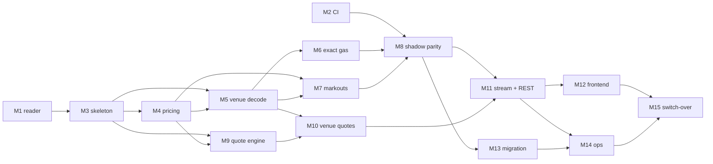

# mpamm.wtf rebuild — implementation plan

How the rebuild in [rebuild-spec.md](rebuild-spec.md) gets built: milestones in order,
the tasks in each, what "done" means, and what waits on DevOps. The spec says *what*
and *why*; this file says *how* and *in what order*. Tick a box when its work is on
`v2` (PR #176); a milestone is done only when its **Done when** checks pass.

Status as of 2026-11-27: phase 1 in progress (M1). The event reader runs on the node
host; nothing else is built yet.

## Ground rules

- **One branch, one PR.** All rebuild work lands on `v2` and in PR #176, which merges
  into `main` only after M15. Today's system on `main` keeps serving until then.
- **The repo is public.** No host names, IPs, RPC URLs, keys or internal node names in
  code, commits, docs or the PR.
- **Correctness first.** Every item in the spec's *Correctness requirements* must hold.
  Today's system is the reference: phase gates compare against it, never against our
  own expectations.
- **Built off the node host.** Release builds come from CI (or `service/scripts/build-linux.sh`
  until CI exists), never from compiling on the host.
- **SDK pinned to the node.** `monad-event-ring` / `monad-exec-events` use the node's
  release tag. A node upgrade means a rebuild against the new tag, shipped together.
- **Measure, then claim.** Every latency or parity statement in a commit or the PR is
  backed by a run on the host or a recorded fixture.

## Milestones at a glance

| # | Milestone | Phase | Depends on | Waits on DevOps for | Status |
| --- | --- | --- | --- | --- | --- |
| M1 | Reader hardening and the 7-day gate run | 1 | — | systemd unit (for the gate run only) | In progress |
| M2 | CI, release artifacts, deploy script | 1 | — | registry credentials (publishing only) | Not started |
| M3 | Service skeleton: crates, config, store, commit pipeline, registry | 2 | M1 | — | Not started |
| M4 | Pricing: exchange feeds, references, late-decode pricing | 2 | M3 | — | Not started |
| M5 | Venue discovery and decode ports (11 venues) | 2 | M3, M4 | archive RPC URLs (backfill) | Not started |
| M6 | Exact gas and attribution | 2 | M5 | — | Not started |
| M7 | Markouts and analytics | 2 | M4, M5 | — | Not started |
| M8 | Shadow run and daily parity (phase-2 gate) | 2 | M5–M7 | systemd unit, env file | Not started |
| M9 | Quote engine | 3 | M3, M4 | — | Not started |
| M10 | Venue quote ports and same-block parity (phase-3 gate) | 3 | M5, M9 | CPU set | Not started |
| M11 | Stream and REST | 4 | M8, M10 | — | Not started |
| M12 | Frontend on the new stream | 4 | M11 | — | Not started |
| M13 | Data migration and replication | 4 | M8 | object storage bucket | Not started |
| M14 | Operations readiness | 4 | M11, M13 | hot fallback WS, TLS hostname, on-call | Not started |
| M15 | Switch-over and merge (phase-4 gate) | 4 | M12–M14 | DNS change | Not started |
| M16 | Edge relays (optional) | 5 | M15 | relay hosting | Only if chosen |
| M17 | In-process EVM (optional) | 6 | M10 | — | Only if needed |



M1's gate run, M2, M3–M7 and M9 can proceed in parallel once M3's skeleton exists.
The gates (M1, M8, M10, M15) take calendar time: start their runs as early as the
code allows.

## Target layout

```text
service/
  Cargo.toml            workspace; SDK pinned to the node tag
  reader/               mpamm-reader: phase-1 tool (stays as a diagnostics binary)
  crates/
    types/              shared types (Fill, QuoteRow, block refs), TS export via ts-rs
    registry/           tokens, assets, pairs, markets, sizes, references (data file loader)
    ring/               event-ring reader library: watch set, block assembly, gaps
    chain/              RPC clients: local node, hosted hot, archive; availability gate
    store/              SQLite schema, migrations, commit batches, revisions
    pricing/            exchange feeds, pair-terms reference, wrapper rates, late pricing
    venues/             Venue trait + one module per venue (+ generations)
    pipeline/           trades at Finalized: decode, price, attribute, gas, markouts
    quotes/             per-block quote jobs, deadlines, late rows, depth curves
    api/                stream (compact schema + dictionary) and REST (axum)
  mpamm/                the service binary: config, wiring, threads, health
  tools/                verify-venue, parity diffs, migration, benchmarks
  registry.toml         the market registry (single source for service and web)
```

---

## Phase 1 — event feed

### M1 · Reader hardening and the 7-day gate run

**Goal:** the reader runs unattended for 7 days, loses nothing, and produces the
measurements the spec needs (proposal delay, execution time, commit timings, ring depth).

- [x] Read the ring with the SDK pinned to the node tag; assemble per-block timelines
- [x] Record arrival, execution, voted / finalized / verified times, abandoned proposals,
      gaps, expired payloads, reader lag, ring depth; per-proposer arrival
- [x] First live run on the host (60 s: 0 gaps, lag 0)
- [ ] 1-hour run analysed: arrival by proposer region, ring depth over time
- [ ] **Gap repair:** on a sequence gap or expired payload, note the block range and
      fetch it from the local node RPC (`eth_getLogs` by block, `eth_getBlockByNumber`
      with transactions); fall back to the archive when the node lacks it
- [ ] **Resume:** persist the last settled block; on start rewind with
      `block_number_prev`; report a gap when that block left the ring
- [ ] **Shutdown:** handle SIGTERM/SIGINT, flush outputs, write a final summary
- [ ] **Rotation:** daily files for `blocks.jsonl`, retention configurable
- [ ] **Health:** a small local HTTP endpoint (or file) with the latest summary, for alerts
- [ ] Run under systemd for 7 days *(DevOps: unit pinned to CPU 0)*

**Done when:** 7 consecutive days with no unrepaired gap; ring depth, execution-time and
arrival distributions published in the PR; restart and repair paths exercised at least
once each on the host.

### M2 · CI, release artifacts, deploy script

- [ ] GitHub Actions job: `cargo fmt --check`, `cargo clippy -D warnings`, `cargo test`
      for `service/` on Ubuntu with clang-19, CMake, libhugetlbfs-dev, libzstd-dev
- [ ] Cache the cargo registry and the Monad git checkout between runs
- [ ] Release build for `x86-64-v3`; publish the binary as a workflow artifact (and to the
      registry DevOps chooses, once credentials exist) tagged with the commit SHA and node tag
- [ ] `service/scripts/deploy.sh`: copy a given build to the host, install as `mpamm`,
      restart the unit, check health, roll back on failure
- [ ] Ring-snapshot fixture tests: record a short snapshot on the host and replay it in
      CI (the SDK reads zstd snapshot files), so the reader is tested without a node

**Done when:** every push to `v2` runs the job green; a deploy and a rollback have been
done with the script.

---

## Phase 2 — trades, volume and gas (shadow)

### M3 · Service skeleton

- [ ] Workspace crates per *Target layout*; `mpamm` binary with config (file + env),
      structured logs (`tracing`), and the thread model from the spec (reader on its own
      core, async runtime for the rest, one SQLite writer thread)
- [ ] `registry`: port `shared/src` (tokens, assets, pairs, markets, sizes, references) to
      `registry.toml`; loader with the same validation as `validateRegistry`
- [ ] `types`: Fill, QuoteRow, BlockRef, stream message types; TypeScript generation
      (ts-rs) into `shared/` so the web build consumes them
- [ ] `ring`: move the reader's logic into a library: watch set (logs by address+topic0,
      transactions by `to` / relay rule, state contracts), block assembly at `BLOCK_END`,
      block-level log index from `log_count` and `txn_count`, commit-state tracking,
      abandonment at finalization, gap reports
- [ ] `store`: new SQLite schema (trades kept forever, daily volume, daily gas with a
      method flag, cursors, revisions, meta), additive migrations, one transaction per
      final block including the cursor
- [ ] `pipeline`: strict block-order commits at Finalized; a gap holds later commits until
      repaired; fail-closed on any source or decode error
- [ ] `chain`: local-node client (pinned reads, explicit gas, JSON-RPC batches), archive
      client with the availability gate, hosted hot client for fallback
- [ ] Revisions: dated, one-shot history repairs as data (equivalent of
      `historyRevisions` / `gasRevisions` / `markets`)

**Done when:** the binary runs on the host with an empty venue list, commits empty final
blocks in order with the cursor, survives a restart mid-stream without a gap, and the
registry and types round-trip into the web build.

### M4 · Pricing

- [ ] Exchange feeds: Kraken WS v2 (book checksums, per-book repair and resubscribe),
      Bybit, Binance; every update kept in memory with its timestamp
- [ ] Pair-terms reference (stable crosses, wrapped/native basis) as in
      `docs/architecture.md` → *The reference is in the pair's own terms*
- [ ] ERC-4626 wrapper rates (wrapped xStocks), read from chain on a schedule
- [ ] Late-decode pricing: exchange history for recent blocks, archived exchange prices
      for closed days (port `closed-day-prices.ts`), chain prints as the last resort;
      fix the known outlier weakness (two legs of one off-market transaction)
- [ ] Market-hours handling (closed assets) and reference starvation detection

**Done when:** for a recorded day, USD for every crypto-quoted fill matches today's
system within its documented tolerance, and late-decode prices beat today's on the
11-15 outlier cases.

### M5 · Venue discovery and decode ports

Port in order of volume. Each venue: discovery (merging), sources (watch set), decode,
generations, revisions, fixture tests (reuse `server/src/venues/__tests__/fixtures`;
record new ones where a venue has none), `verify-venue` run on the live node.

- [ ] Hanji (17 CLOBs, wrapped xStocks, FastLane quoters)
- [ ] Metric (v0 decode-only generation, v1)
- [ ] WOOFi
- [ ] ThogAMM (proxy upgrades, unwrapped xStocks still unlisted today)
- [ ] POE (no fixtures today: record some)
- [ ] Capricorn
- [ ] BTR (executors)
- [ ] Crystal (vault maker scope)
- [ ] Uniswap v4 (hooks / pool discovery)
- [ ] Clober (on-chain book classification, subgraph fallback)
- [ ] Lunarbase (paused; decode only until it resumes)
- [ ] `tools/verify-venue` (port of `verify-adapter`)
- [ ] Rewrite `docs/adapters.md` for Rust venue modules

**Done when:** every fixture decodes to the same fills as today's adapters; each venue's
fills for one full recorded day match today's database id-for-id with exact USD.

### M6 · Exact gas and attribution

- [ ] Gas destinations and relay rules from each venue's sources (FastLane handler word)
- [ ] Cost per transaction = gas limit × price paid by type (legacy and access-list:
      `gasPrice`; EIP-1559 and later: min(max fee, base fee + priority fee))
- [ ] Gas written with the block's trades and cursor; method flag and cutover date stored
- [ ] Attribution (router labels, FastLane category) from `TXN_HEADER_START`
- [ ] Fallback path: exact gas from full blocks over RPC when the ring has a gap

**Done when:** exact gas for three sampled days equals an independent chain recount, and
sits within today's estimate's error band per venue.

### M7 · Markouts and analytics

- [ ] Markouts at 0 / 5 / 10 / 30 / 60 s anchored on `proposal_epoch_nanos`, against
      the pair-terms reference from the exchange update history
- [ ] Markout curves and the markout model version
- [ ] Analytics: leaderboard windows (1 / 7 / 30 days), percentiles (exact, in a worker),
      volume and gas series, quote stats
- [ ] Flag trades whose time fell back to the block second (repaired over RPC)

**Done when:** for a recorded day, markouts match today's within the expected shift from
the precise anchor, and every analytics endpoint's numbers match today's.

### M8 · Shadow run and daily parity (phase-2 gate)

- [ ] Run the service on the host with its own database beside today's production
- [ ] `tools/parity`: daily diff against today's system: trade id sets, USD per trade,
      volume and counts per venue-day; reports every difference with its cause
- [ ] Exact-gas check against a chain recount for sampled days
- [ ] Gap and restart drills during the run

**Done when:** 7 consecutive days with identical trade ids, USD and per-venue volume, and
exact gas matching the recount. *(DevOps: unit, env file with archive URLs.)*

---

## Phase 3 — quotes

### M9 · Quote engine

- [ ] One quote job per proposed block, started from the reader's "block executed" signal;
      venues whose watched contracts changed go first; one job in flight per venue
- [ ] Pinned reads on the local node with a short retry: a just-announced block's state is
      readable 3–5 ms later (9 ms worst case, measured 2026-11-27)
- [ ] Explicit gas ≤ 8.1M per call; JSON-RPC batches for independent calls
- [ ] Per-venue deadline (150 ms default); late rows greyed for up to 3 blocks, never compared
- [ ] Reference frame captured per job; CEX comparison columns per venue
- [ ] Depth curves at today's cadence
- [ ] Per-venue timings on the health endpoint

**Done when:** with stub venues, jobs start within 1 ms of `BLOCK_END` and the engine keeps
pace with every block for 24 h without a missed job.

### M10 · Venue quote ports and same-block parity (phase-3 gate)

- [ ] Port each venue's quote path (same order as M5); split Hanji's helper call and
      Uniswap v4's 22M / 150M calls under 8.1M gas
- [ ] `tools/quote-parity`: quote the same pinned block with today's adapter and the Rust
      module, diff every row (within display precision)
- [ ] Per-venue timing on the host under live load

**Done when:** every venue's rows match today's at the same block, and per-venue p90 is at
most 60 ms. *(DevOps: CPU set for the service.)*

---

## Phase 4 — delivery and switch-over

### M11 · Stream and REST

- [ ] Stream: compact schema, preset-dictionary deflate once per topic, topics `head` /
      `quotes` / `trades` / `depth` / `volume` / `state`, per-venue quote messages batched
      over 20 ms, merged snapshots, sequence numbers and resync, per-viewer backpressure
- [ ] Dictionary build, hashing and serving; JS inflate on the client side
- [ ] REST: every endpoint the UI uses today, with the rebuild's semantics
      (`/api/bootstrap`, `/api/markets`, `/api/quotes`, `/api/quotes/history`,
      `/api/quotes/stats`, `/api/fills`, `/api/volume`, `/api/gas`, `/api/venues`,
      `/api/leaderboard`, `/api/leaderboard/publication`, `/api/markout-curves`,
      `/api/analytics/:revision.json`, `/api/depth`, `/api/depth/stream`, `/api/health`)
- [ ] Byte-budget test on a recorded session (target: ~3.5 KB/s per Execution tab)

**Done when:** a recorded session replays through the stream within budget, and every
REST endpoint returns the same data as today's for the same window.

### M12 · Frontend on the new stream

- [ ] Stream client for the new protocol (dictionary, compact schema), keeping the
      SharedWorker connection
- [ ] Adapter from the new messages to today's view models; per-channel stores
- [ ] Render rules: late rows greyed up to 3 blocks, trades at Finalized, header ticker
      with commit state, stall banner
- [ ] `?timing=1` measuring proposal → paint

**Done when:** today's four tabs work unchanged on the new backend, verified in the
browser, with proposal → paint p50 at most 200 ms near the host.

### M13 · Data migration and replication

- [ ] `tools/migrate`: snapshot today's database, transform into the new schema (trades
      with markouts and curves, daily tables, revision markers), verify against the chain
- [ ] Continuous replication of the new database off the host (write-ahead-log copy to
      object storage and a replica on Railway) *(DevOps: bucket)*
- [ ] Restore drill: rebuild the database from the copy on another machine

**Done when:** a full migration rehearsal verifies with zero differences, and the restore
drill completes.

### M14 · Operations readiness

- [ ] systemd units and CPU sets as agreed with DevOps; environment and secrets layout
- [ ] Fallback mode: heads, quotes and final-block reads from the hosted hot node when the
      local node is down *(DevOps: hot node WebSocket with `monadNewHeads`)*
- [ ] Alerts: node behind, ring lag, unrepaired gap, no final commit for 3 s, venue outages
- [ ] Runbooks: node upgrade (rebuild against the new SDK tag), node resets, host loss,
      rollback to the standby
- [ ] Load test at peak traffic (replay or synthetic) with the node under load
- [ ] Public endpoint: TLS hostname, firewall *(DevOps)*
- [ ] Rewrite `AGENTS.md` and `docs/deploy.md` for the Rust service

**Done when:** each runbook has been executed once on the host, and fallback mode has
served live traffic during a planned node restart.

### M15 · Switch-over and merge (phase-4 gate)

- [ ] Final migration and catch-up from the snapshot cursor
- [ ] DNS to the host; Railway keeps page files, replica and today's system as standby
- [ ] Rollback drill (DNS back to the standby and forward again)
- [ ] Merge PR #176

**Done when:** nothing lost (migration verified), stream bytes within budget, quote
p50 at most 200 ms near the host, and the rollback drill passed.

---

## Optional

- **M16 · Edge relays** — only if viewers far from Amsterdam matter: relays holding one
  upstream per topic and passing bytes through unchanged.
- **M17 · In-process EVM** — only if a venue misses M10's timing: a mirror of its storage
  from `STORAGE_ACCESS` plus revm running the venue's deployed quoter.

## DevOps tracker

| Ask | Needed by | Status |
| --- | --- | --- |
| Node host with event ring, local RPC + WS | M1 | Done |
| systemd unit for the reader (CPU 0) | M1 gate run | Asked |
| Env file with archive and hot-fallback RPC URLs | M5 backfill, M8 | Asked |
| CPU set for the service | M10 | Asked |
| Registry credentials for CI publishing | M2 (publishing) | Asked |
| Bigger event ring at the next node restart | Not blocking | Asked |
| Hot-fallback node WebSocket (`monadNewHeads`) | M14 | Asked |
| Object storage bucket | M13 | Asked |
| TLS hostname, firewall for the public endpoint | M14 | Asked |
| Node-upgrade notice | Ongoing | Asked |
| Build toolchain on the host (optional) | — | Asked |

## Open decisions that affect the plan

- Exact recount of past days' gas before the cutover (M6) — open.
- Re-indexing trades older than 31 days (M13) — open.
- Storing quote history beyond memory (M3 schema, M11) — open.
- Hosting budget and a second host (M14) — open.
- Edge relays (M16) — open.
