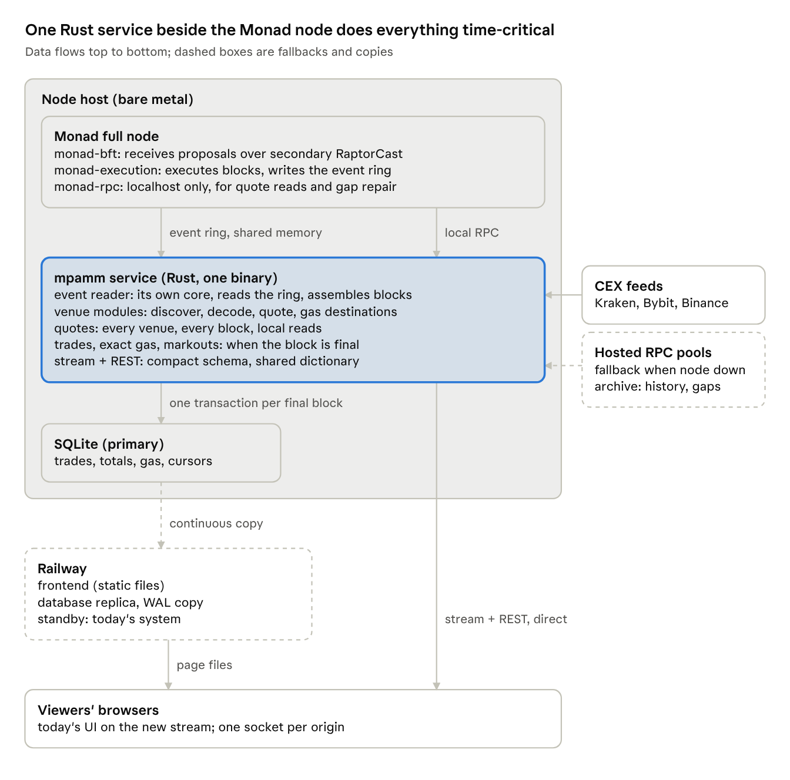
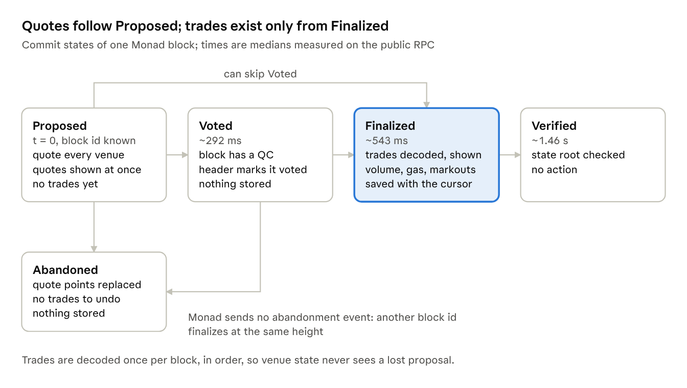
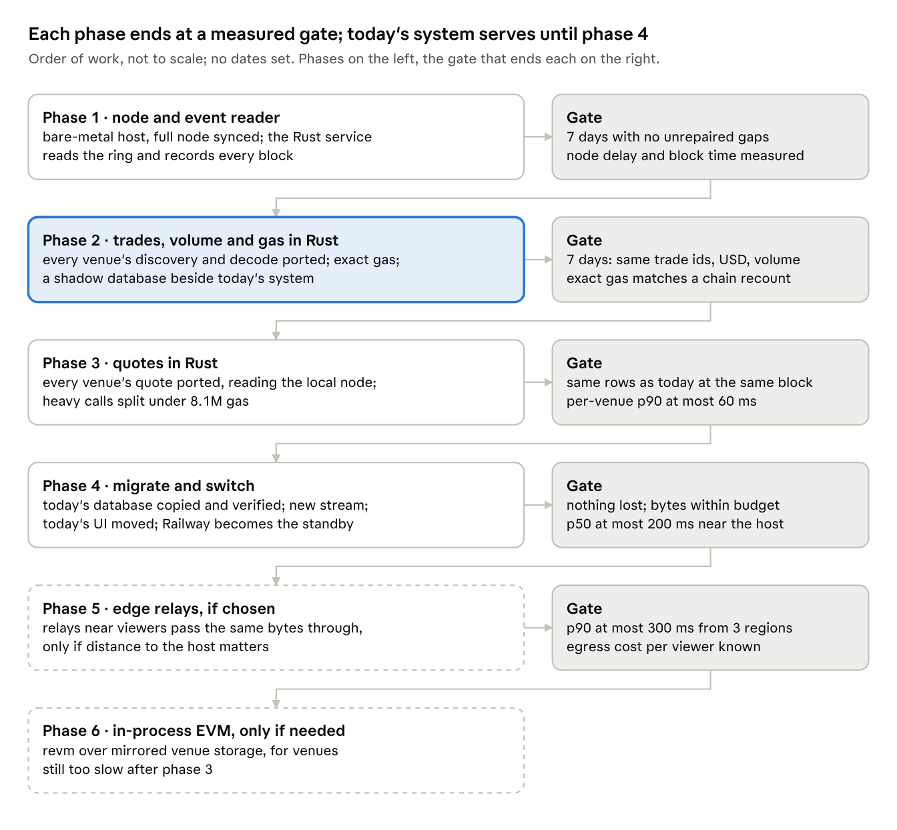

# mpamm.wtf rebuild spec

Status: draft for review, 2026-11-26. Exported from the Claude Doc of the same name; drawings are in `docs/assets/rebuild-*.png`.

mpamm.wtf is rebuilt as one Rust service running beside its own Monad node. It reads Monad's Execution Events, shows each venue's quote within one block of the block being proposed, and counts each trade when its block is final. Today's code and design are inputs, not constraints: what carries over is the correctness of the numbers.

## Goals and non-goals

The rebuild should show each venue's quote within one block of the block being proposed, and count each trade within about 0.7 s, with exact gas and no history lost. Today a quote takes about 530 ms and a trade about 2 s ([mpamm.wtf latency & v2](https://claude.ai/artifact/GaN6dyJDC3Lo5Szmzf9njk)). This is the real-time core of [mpamm.wtf 2.0 (#100)](https://github.com/haythemsellami/mpamm.wtf/issues/100).

### Goals

| Goal | Target | Today (measured 2026-11-24) |
| --- | --- | --- |
| Quote on screen after its block is proposed | p50 ≤ 200 ms, p90 ≤ 300 ms (one block), for viewers near the host | \~530 ms mean, from a laptop far from Virginia |
| Trade on screen and counted | When its block is final: about 0.6 s after proposal, plus the pipeline | 1.8–2.1 s |
| Gas burn | Exact per transaction, updated at each final block | A sampled estimate (≈), refreshed every 60 s |
| One slow venue | Never delays or blanks the others | Delays the whole frame; can blank REST snapshots (503) |
| Exactness | Every trade and its USD match the chain, as in the weekly audits | Exact (2026-11-22 recount: 44,950 fills) |
| Provider outages | Live data keeps flowing with hosted RPCs down | The fills tail held for 4 days on 2026-11-12 |
| History | Nothing lost in migration; every trade kept from cutover on | Individual trades are pruned after 31 days |

These are design targets, checked by the rollout gates. Monad's docs don't say how long a proposal takes to reach a full node, so the first hop is unmeasured until phase 1.

### Non-goals

- Changing what the dashboard measures. Venues, markets, references, sizes and markout horizons are the product; how they are computed is open.
- Showing trades before their block is final. Trades appear and count at Finalized only. Monad has no global mempool anyway (`newPendingTransactions` is not supported).
- Running a validator, or serving public RPC from our node.
- Replaying quotes older than about 3 hours from our own node. A full node keeps only \~40,000 blocks of state, so that stays on archive providers.
- A UI redesign. Today's UI moves to the new stream first, and a redesign follows as its own track. The backend is not shaped around today's UI.

**Not constraints.** Today's language (TypeScript), adapter interface, SQLite schema, stream protocol, frontend data flow and Railway-only hosting are all open. Today's system stays the reference implementation: the rollout gates check the rebuild's numbers against it.

## Decisions

Thirteen choices are settled; the open ones are under Open questions. Each section below follows from this table.

| Area | Decision | Why |
| --- | --- | --- |
| Backend language | Rust for the whole backend: event reader, venue modules, quotes, trades, gas, markouts, store, stream and REST. The frontend stays TypeScript. | One language, no garbage-collector pauses, direct access to the event ring, and an in-process EVM when needed. |
| Trades | Shown and counted only when their block is final | No retractions and no speculative decoding, and still about 3.5× faster than today. |
| Late quotes | A venue that misses a block stays on screen, greyed and labelled with its age, for up to 3 blocks (\~1 s). It is never used in comparisons. | One miss doesn't make a venue flicker, and no stale price lingers. |
| Gas | Exact per transaction, from a marked cutover date | The event feed sees every transaction; this ends a ±5–10% estimate. |
| Time | Trades and markouts use the block's proposal time (`proposal_epoch_nanos`), not the 1-second block timestamp | Markouts anchor on when the trade happened, not up to a second earlier. |
| Quote computation | `eth_call` to the local node first. An in-process EVM (revm) over a mirror of venue storage for any venue still too slow. Never a native re-implementation of a venue's pricing. | The venue's deployed contract stays the source of truth. |
| Venue model | The same shape as today (discover, sources, decode, quote, gas), as a Rust trait | The venues differ too much for a declarative format. |
| Store | SQLite, with its primary copy on the node host, a new schema, and every trade kept | One writer; about 14 MB of trades a day. |
| History | Copy everything from today's database, verify it against the chain, archive the old file | Stored markouts cannot be recomputed. |
| Stream encoding | A compact schema, compressed once per topic with a shared preset dictionary; one message per venue | Measured 3.5 KB/s per viewer, against 9.6 KB/s today. MessagePack did not beat today's gzip. |
| Hosting | A bare-metal host runs the node, the service and the database primary. Railway serves the frontend and keeps a database replica and a standby. | Monad needs bare metal, and SQLite lives beside its writer. The provider, region and budget are open. |
| Monitoring | Server-side metrics only; no real-user or synthetic probes for now | Enough for the rollout gates. |
| Naming | No version names. This doc says "the rebuild"; the product is just mpamm.wtf. | — |

## Monad facts the design relies on

Monad publishes every block's data at the Proposed state, a few hundred ms before it is final. The fastest feed, Execution Events, can only be read on the node's own host. Timings below are our measurements; everything else comes from the docs listed under Sources.

| Fact | Detail | What the rebuild does with it |
| --- | --- | --- |
| Block time | 300 ms since MIP-12 (mainnet v0.15.1, 2026-07-23). We measured a 305 ms average on 2026-11-22. | Everything is budgeted against one 300 ms block. |
| Commit states | Proposed → Voted (QC) → Finalized → Verified. On the public RPC, Voted came 292 ms after Proposed, Finalized 543 ms and Verified 1,459 ms (medians over 20 s). A block can skip Voted. | Quotes at Proposed; trades, gas and storage at Finalized. Verified is not needed. |
| Block identity | Before finalization a block is identified by its block id, not its number. Two proposals can share a number. A losing proposal is never announced: another block is finalized at that height. | Speculative quotes are keyed by block id; abandonment is inferred at finalization. |
| Speculative execution | Execution runs on proposed blocks before consensus decides. `latest` = Proposed, `safe` = Voted, `finalized` = Finalized. The state root trails by D = 3 blocks. | Quotes read Proposed state, pinned to the block hash. |
| Execution Events | A shared-memory ring written by the execution daemon, readable only on the same host. SDKs in C (`libmonad_event`) and Rust (`monad-event-ring`, `monad-exec-events`). | The service reads the ring directly, in Rust. |
| Event timing | `BLOCK_START` comes as execution begins, the first `TXN_HEADER_START` about 1 ms later, and most transaction events less than 1 µs after the transaction completes. | A block's logs and state changes are known within its execution time. |
| Event order | Different transactions' events can interleave. Within one transaction: logs, then call frames, then state accesses, each in index order. A log's `index` counts within its transaction. | The block-level log index used in trade ids is computed from earlier transactions' `log_count`. |
| State changes | `STORAGE_ACCESS` carries address, slot key, `start_value`, `end_value` and a `modified` flag; `ACCOUNT_ACCESS` carries balance and nonce changes. | The service knows which venue contracts changed in each block. |
| Ring overwrite | The ring never waits for readers. A slow reader loses events, detected by a sequence-number gap or an expired payload. The default size holds "several minutes" of blocks at 10k TPS. | Gaps are repaired from the node's RPC, then from hosted archives. |
| Schema hash | The ring header carries a hash of the event layouts; a reader built for another node version must not read it. | The service build is pinned to the node version; both upgrade together. |
| `eth_call` pools | Calls at or under 8,100,000 gas run in a pool of 1,000; larger ones in a pool of 20. A call with no gas limit that runs out in the small pool is retried in the large one. Our own node caps `eth_call` at 30M gas by default. | Every quote call sets its gas and stays under 8.1M. |
| Batch vs Multicall3 | A JSON-RPC batch runs its calls in parallel; Multicall3 runs them one after another. | Large multicalls are split into parallel batches. |
| History on a full node | All historic blocks, receipts and logs (providers back older data with a separate archive), and as much state as the disk holds: "about 40,000 blocks" on a 2 TB disk, about 3.3 hours. Traces need `--trace_calls`. `rpc2.monad.xyz` and `rpc-mainnet.monadinfra.com` serve old state. | History and gap repair beyond the node keep the hosted archive pool. |
| Hardware | Bare metal only ("Cloud-based environments are not officially supported"): 16 cores at 4.5 GHz+, 32 GB+ RAM, 2 TB NVMe for TrieDB plus 500 GB, PCIe Gen4x4, 100 Mbit/s. | The node host is a dedicated server. |
| Block delivery | Full nodes receive proposals over secondary RaptorCast from validators, in groups of up to 150, and may join several groups. Propagation time is not documented. | Join three groups; measure the delay in phase 1. |
| Node recovery | Soft and hard resets skip execution, leaving no local logs or receipts for skipped blocks. A full replay re-executes them: slower, but no gap. | After a reset, the service backfills the skipped range from hosted RPCs, using its cursor. |
| WebSocket on our node | `--ws-enabled` requires the event ring; without it, RPC exits with an error. `monadNewHeads` / `monadLogs` read the same ring. | Local subscriptions fail together with the ring; the independent cross-check is the hosted pool's `monadNewHeads`. |
| Timestamps | Block `TIMESTAMP` has 1-second granularity; about 3 blocks share each second. `BLOCK_START` carries `proposal_epoch_nanos`, and every event descriptor carries `record_epoch_nanos`. | Trades and markouts use the proposal time. |

## Architecture

One Rust service on the node's host does everything time-critical: it reads the event ring, quotes every venue, counts trades, and serves the stream and REST. Railway keeps the page files, a copy of the database and today's system as a standby.



| Part | Runs on | Owns |
| --- | --- | --- |
| Monad full node | Node host | Receiving and executing blocks, the event ring, local RPC |
| Event reader | The service, on its own core | Reading the ring, the watch set, block assembly, gap detection |
| Venue modules | The service | Each venue's discovery, sources, decoding, quoting and gas destinations |
| Quote engine | The service | Per-block quote jobs, deadlines, late venues |
| Trade pipeline | The service | Decoding at Finalized, pricing, attribution, exact gas, markouts |
| Store | The service, with SQLite on the host | Trades, totals, cursors and revisions; a continuous copy to Railway |
| Stream and REST | The service (`axum`) | Compact schema, dictionary compression, subscriptions, snapshots |
| Exchange feeds | The service | Kraken, Bybit and Binance references |
| Hosted RPC pools | Providers | Fallback mode, history, gap repair beyond the node |
| Railway | Railway | Page files, the database replica, the standby |

**One process, separated by threads.** The event reader owns a pinned core and never waits on anything. Quote jobs and the trade pipeline run on an async runtime, and SQLite writes go through one writer thread. A crash restarts the whole service, which resumes from its cursor in seconds (see Failure modes).

## Hosting and the node host

One bare-metal server runs the Monad node, the mpamm service and the database's primary copy. Railway keeps the frontend, a continuously updated database replica, and today's system as a standby. Viewers connect to the host directly for the stream.

### Layout

| Place | Runs | Why |
| --- | --- | --- |
| Bare-metal host | Monad full node, the mpamm service, SQLite primary | Execution Events are readable only on the node's host. SQLite lives beside its one writer, so no internet link sits inside the counting path. |
| Railway | Frontend static files; a database replica fed continuously from the host; today's system as a standby origin | An off-host copy restorable in minutes, and a standby that already runs. |
| Object storage | A continuous copy of the database's write-ahead log (for example Litestream to an S3-compatible bucket, such as a Railway bucket) | Point-in-time recovery if the host is lost. |
| Viewers | Stream and REST from the host; static files from Railway or a CDN | Proxying the stream through Railway would add a hop to every message. |

**Why the primary database isn't on Railway:** SQLite is a file inside the process that writes it, and the service writes at every final block. A primary on Railway would mean Postgres over the internet. Every count of trades, volume and gas would then depend on the link between two providers. If that link dropped, counting would stop until it came back: correct, but stalled. The replica on Railway gives the off-host copy without that dependency, and it can serve history queries if we ever want them off the node host.

### Hardware

Monad's docs set the same hardware for full nodes as for validators, except bandwidth:

| Part | Requirement | Note |
| --- | --- | --- |
| CPU | 16 cores at 4.5 GHz+ base (e.g. Ryzen 9950X / 7950X, EPYC 4584PX) | The service needs cores of its own; see CPU layout. |
| RAM | 32 GB+ | The event ring lives in huge pages, which come out of this budget. |
| Storage | 2 TB NVMe for TrieDB, 500 GB for MonadBFT / OS, both PCIe Gen4x4 | The docs rank Samsung 980/990 Pro first and flag Nextorage as unreliable. SQLite goes on the 500 GB disk or a third disk. |
| Network | 100 Mbit/s for a full node | Plus the stream's outbound traffic to viewers. |

### Node configuration

- Install a full node per the [full-node installation guide](https://docs.monad.xyz/node-ops/full-node-installation.md), as systemd units: `monad-bft`, `monad-execution`, `monad-rpc`.
- Mount hugetlbfs with `hugeadm --create-user-mounts monad` in a oneshot unit, so it survives reboots.
- Start execution with `--exec-event-ring <hugetlbfs path>/event-rings/monad-exec-events`. Set the size shifts explicitly (`<name>:<descriptor-shift>:<payload-buffer-shift>`) so the ring holds at least 10 minutes of blocks, long enough to restart the service without a gap. Size `/proc/sys/vm/nr_hugepages` to match, or execution exits with "no space left on device".
- Start RPC with `--exec-event-path` (the same ring) and `--ws-enabled`, bound to localhost only.
- Leave `--eth-call-provider-gas-limit` at its 30M default; every quote call stays under 8.1M anyway.
- Disable `--trace_calls`, which the Debian package turns on by default. Nothing needs call frames: attribution and relay gas read a transaction's `to` and calldata from `TXN_HEADER_START`.
- In `node.toml`, set `enable_client = true` and `max_num_group = 3` (the documented example), so proposals arrive from up to three validators. The docs say full nodes "can (and should) join multiple secondary RaptorCast groups for redundancy."

### CPU layout

The node needs its cores on time; the docs exclude VMs for exactly that reason. Node daemons and the service run in separate cgroups with separate core sets. The event reader gets a core of its own, because at 10k TPS it has "about 10 microseconds to process each event." Phase 1 measures how many cores the service needs under load.

### Placement

The host should sit where proposals reach it fastest, since viewers' distance is handled separately (edge relays are an open question). The docs give no propagation figures, so phase 1 measures how long `BLOCK_START` trails each block's `proposal_epoch_nanos` in two or three candidate regions. A validator can also list our node under `full_nodes_prioritized`, which needs an agreement with that validator's operator.

### Upgrades and recovery

- Monad ships node releases often (v0.16.0 to v0.16.7 so far). The service reads the ring's event layouts, pinned to the node version by the schema hash, so each node upgrade ships with a matching service build. During the window, the service runs in hosted fallback mode (see Failure modes).
- If the node falls behind, the docs offer a soft reset (statesync), a hard reset (snapshot) or a full replay. The first two skip execution, leaving no local logs or receipts for the skipped blocks; the service backfills that range from the hosted archive pool. A full replay leaves no gap but takes longer.
- Hosted RPC pools stay configured: hot for fallback mode, archive for history and gap repair. Their credentials live in the host's environment, never in code or logs.

### Exposure

The host exposes only the service's public port (stream and REST, over TLS) and the node's P2P ports. RPC, WebSocket and the ring stay local.

## Event reader

A dedicated thread in the service reads the event ring, keeps only what the venue modules watch, and assembles each block. It holds no business logic: no prices, no USD, no venue names. It does two jobs: it tells the quote engine which venues changed at Proposed, and it hands the trade pipeline each block's data at Finalized.

### What it reads

The reader uses `ExecEventRing` and `EventReader` from `monad-event-ring` and `monad-exec-events`. It tracks commit states itself from the consensus events, and infers that a proposal was abandoned when another block id finalizes at its number. The SDK's `CommitStateBlockBuilder` reports abandonment explicitly, but it sits on `ExecutedBlockBuilder`, which copies every block whole. So it serves as a test oracle, not as the hot path.

| Event | Used for |
| --- | --- |
| `BLOCK_START` | Opens a block: block id, proposed number, round, epoch, parent hash, execution inputs (timestamp, base fee, transaction count), and `proposal_epoch_nanos`. |
| `TXN_HEADER_START` | Transaction hash, sender, `to`, type, gas limit, gas price or fee caps, and calldata: for gas and attribution. |
| `TXN_EVM_OUTPUT` | The receipt: status, `log_count` (for block-level log indexes) and gas used. |
| `TXN_LOG` | Address, topics and data of each log from a watched address. |
| `ACCOUNT_ACCESS` / `STORAGE_ACCESS` | Which watched contracts changed, with slot keys and start and end values. |
| `BLOCK_END` | Closes the block: Ethereum block hash and execution outputs. |
| `BLOCK_QC` / `BLOCK_FINALIZED` / `BLOCK_VERIFIED` | Commit-state changes. |
| `BLOCK_REJECT`, `TXN_REJECT` | A proposal, or a transaction, that produced nothing. |

Call frames, access-list entries and perf events are skipped.

### The watch set

The venue modules declare what to watch. The set is rebuilt after each discovery (every 10 minutes), applied from the next `BLOCK_START`, and only ever grows by merging.

- **Logs:** (address, topic0) pairs from every module's sources: trades, state and attribution, plus log-based gas sources.
- **Transactions:** every transaction whose `to` is a venue's gas destination, or a relay whose calldata names one (FastLane's handler, for example), for exact gas. Also every transaction that emitted a watched log, for attribution.
- **State:** contracts whose storage changes should move a venue to the front of the block's quote job.

A log's address and topics sit in its payload, so the reader reads the head of every `TXN_LOG` and `TXN_EVM_OUTPUT` payload and copies only matches. It uses the zero-copy `try_filter_map` API, which discards results whose payload expired mid-read. The descriptor's flow tags (block, transaction and account index) let it skip unwatched event types and accounts without touching payloads.

### What it produces

| Output | When | Contents |
| --- | --- | --- |
| Block executed | At `BLOCK_END` (Proposed) | Block id, number, hash, proposal time, base fee, and the watched contracts that changed. The quote engine starts from this. |
| Block data | Held in memory until the block's fate is known | Watched logs (with transaction hash, transaction index and block-level log index) and watched transactions. |
| Block final | `BLOCK_FINALIZED` | The finalized block id. The trade pipeline takes that block's data, and any other proposal at the same height is dropped. |
| Gap | Sequence gap or expired payload | The sequence range lost and the block numbers it touched. |
| Heartbeat | Every second | Writer and reader sequence numbers, so ring lag is visible. |

A log's ring `index` counts within its transaction, while trade ids use the index within the block. The reader adds the `log_count` of every earlier transaction, using `BLOCK_START`'s transaction count to know when every receipt is in; a rejected transaction adds no logs. Trade ids therefore stay `venue-txHash-logIndex`, identical to today, so migrated history and new trades never collide or double up.

### Restart and gaps

- On start, the service resumes from its last committed final block + 1. The reader rewinds to the oldest event still in the ring and replays from there. If that block has already left the ring, it reports a gap straight away.
- A sequence gap or expired payload never stops the reader. It reports the gap and carries on at the next `BLOCK_START`.
- Commits wait for gap repair: the service fetches the missing blocks from the node's own RPC (`eth_getLogs` by block hash, plus full blocks for gas and attribution). It falls back to the hosted archive pool when the node itself lacks them, after a reset.

## Block lifecycle

The service acts twice per block: it quotes at Proposed, and it decodes and counts trades at Finalized. Voted and Verified change only a label.



- **Keys:** before Finalized, quotes are keyed by block id. After it, everything is keyed by block number.
- **Skipping:** a block can go straight from Proposed to Finalized, so Voted is optional.
- **Lag:** if execution lags consensus, `BLOCK_START` can arrive after consensus has voted. The docs say execution "implicitly considers everything it executes to only be proposed", so the service relies on the order of events, not their timing.
- **Order:** final blocks commit strictly in order. A missing block holds every later commit until it is repaired.

## Quote engine

The quote engine quotes every venue at every block, pinned to that block, reading from the node next door. It publishes each venue as soon as that venue is done. A quote is not in the event stream: it only exists by running the venue's own pricing code against the block's state, so the engine runs that code for every venue as soon as the block has executed.

### Trigger and order

- The reader's "block executed" output starts a quote job for that block id, with the block hash already known.
- Every venue is quoted at every block, so every row describes one explicit block.
- Venues whose watched contracts changed in the block go first, so a busy block shows what moved soonest.
- Each venue has at most one job in flight. A venue still quoting block B skips B+1, and its row is late for that block. Other venues never wait.

### Reads

- Venue modules read through an `alloy` provider pointed at the node's RPC on localhost. Every state read is pinned to the block hash, so all reads in a job see one proposal.
- Every quote `eth_call` carries an explicit gas limit of at most 8,100,000. A read that needs more fails loudly instead of being retried in the 20-slot pool. The heavy reads found today are split during the port: Hanji's helper call (8.72M) and Uniswap v4's 22M and 150M calls.
- Independent calls go out as one JSON-RPC batch, which the node runs in parallel; the local node has no provider batch limits.
- The pair-terms reference (exchange mid, wrapper rate, stablecoin cross) is captured once at the start of each job.

### Deadlines and late venues

- Each venue gets a deadline per block: 150 ms by default, configurable. A venue that misses it is late only for itself.
- A late venue stays on screen with its last rows, greyed and labelled with their age, for up to 3 blocks (about 1 s). After that it is hidden until it quotes again.
- Late rows never take part in same-block comparisons (best price, spread chart, rankings, the CEX columns).
- With local reads, misses should be rare. Expected causes are a saturated host, a hung call, or a service restart.

### Publishing

- When a venue finishes, its rows go straight to the stream, tagged with block number and block id. The CEX comparison columns are computed for that venue at that moment, against the job's reference.
- The stream batches each topic over 20 ms, so a block produces a few messages per topic, not one per venue.
- If the proposal is abandoned, the next block's rows replace its rows.
- REST returns each venue's latest rows with their block and age. One missing venue never blanks a snapshot.

### Depth curves

Depth curves keep today's cadence: they follow each head and coalesce while a pass runs, reading from the local node.

### Later: in-process EVM

For any venue still too slow after local reads, the service can keep a mirror of that venue's storage, fed by `STORAGE_ACCESS` end values plus cold slots fetched from the node. It then runs the venue's own quoter bytecode in an embedded EVM (revm), without any RPC. The deployed contract stays the source of truth; nothing is re-implemented natively. This is the last rollout phase, used only where measurements call for it.

## Venue modules in Rust and the port

Every venue adapter becomes a Rust module implementing one trait. The registry becomes data that the service and the frontend both read. Each venue joins the rebuild only after it matches today's adapter exactly, so the port is proven one venue at a time while today's system keeps serving.

### The venue trait

```rust
#[async_trait]
pub trait Venue: Send + Sync {
    /// Static metadata: id, name, colours per theme, role, first day.
    fn meta(&self) -> &[VenueMeta];

    /// Re-runs every 10 minutes. Must merge into existing state, never replace it.
    async fn discover(&self, cx: &Ctx) -> Result<()>;

    /// What the event reader watches: trade, state and attribution logs,
    /// gas destinations and relay rules, and contracts whose changes reorder quoting.
    /// An Err holds the cursor (fail-closed).
    fn sources(&self) -> Result<Sources>;

    /// Turn one final block's watched logs into trades. Runs once per block, in block order.
    /// An Err holds the cursor; a single malformed log is skipped and noted instead.
    fn decode(&self, cx: &DecodeCx, block: &FinalBlock) -> Result<Vec<Fill>>;

    /// Quote every market and size at one block, through a client pinned to that block.
    async fn quote(&self, cx: &QuoteCx, block: &BlockRef, sizes: &[f64]) -> Result<Vec<QuoteRow>>;

    /// One-shot, dated history repairs shipped with a decode or gas change.
    fn history_revisions(&self) -> &[HistoryRevision] { &[] }
    fn gas_revisions(&self) -> &[GasRevision] { &[] }
}
```

A protocol that redeploys keeps one venue id, with one module per contract generation behind a wrapper, as today's `composeGenerations` does. Because `decode` only ever runs on final blocks, in order, it may keep state between blocks (Clober's `Open`, ThogAMM's upgrade events, Capricorn's and Metric's `PoolCreated`) without any speculative copy.

### The registry

Tokens, assets, pairs, markets, sizes and references live today in `shared/src` (1,058 lines of TypeScript), imported by both server and web. In the rebuild they become one data file read by the service, and bundled into the frontend. The stream's message types are generated for TypeScript from the Rust definitions (for example with `ts-rs`), so the service and the frontend cannot drift.

### What gets ported

Today's backend is about 19,600 lines of TypeScript plus 18,300 lines of tests. Some areas are ported, others are replaced by the new design.

| Area | Today (TS lines) | In the rebuild |
| --- | --- | --- |
| Venue adapters (11 venues, reference venues, generations, quote health) | 6,395 | Ported, venue by venue, with parity gates |
| Live pipeline (quote loop, fills tail, backfill, revisions, notes) | 5,848 | Redesigned around the event reader, not ported line by line |
| Chain and RPC (pools, failover, head watcher) | 1,173 | Pools and the availability gate ported; the head watcher is replaced by the reader |
| Exchange feeds (Kraken WS v2 with checksums and per-book repair, Bybit, Binance) | 806 | Ported |
| Gas tracker | 732 | Replaced by exact gas from events; an RPC path stays for gaps |
| Store and persistence | 1,140 | New schema, `rusqlite` |
| Analytics and markouts (leaderboards, percentiles, markout aging and curves) | 716 | Ported |
| Depth curves | 536 | Ported |
| Pricing (pricer, fill-time prices, closed-day exchange archives, ERC-4626 wrapper rates) | 365 | Ported |
| History planning | 521 | Ported |
| HTTP, stream, notes, attribution, config | 1,581 | Rewritten on `axum`, with the new stream |
| Shared registry | 1,058 | Becomes data plus generated types |
| Tests (90 files) and recorded fixtures (13) | 18,278 | Fixtures reused as they are (they are chain data); expectations re-derived and checked |

Suggested building blocks: `tokio`, `axum`, `alloy` (ABI and RPC), `rusqlite`, `monad-event-ring` / `monad-exec-events`, `tokio-tungstenite` (exchange feeds), `flate2` (deflate with a preset dictionary), `serde`, `tracing`, and later `revm`.

### How the port is proven

1. **Fixtures:** every recorded log fixture decodes to the same trades in both implementations.
2. **Shadow trades:** the service runs on the host and writes its own database while today's system serves. Every day, trade ids, USD values and per-venue volume must match exactly.
3. **Quote parity:** for each venue, both implementations quote the same pinned block. Rows must match within the stream's display precision (0.01 bp, 7 significant digits).
4. **Gas:** exact gas is checked against a chain recount for sampled days, and against today's estimate within its known error.

### Venue authors

`docs/adapters.md` is rewritten for Rust, with a template module and a ported `verify-venue` command that checks discovery, decoding and quoting against the live chain. Outside contributors, such as the Hanji engineer behind recent PRs, write Rust from then on.

## Trades, volume, gas and markouts

A trade is decoded, priced, attributed and counted when its block is final, and stored with the cursor in the same transaction. Nothing speculative is ever shown or stored, so there is nothing to retract and no un-count path to need.

### When a block is final

1. The reader reports `BLOCK_FINALIZED` for a block id. Any other proposal at that height is dropped.
2. Each venue module decodes that block's watched logs into trades. Blocks are processed strictly in order, and a missing block (a gap) holds every later one until it is repaired.
3. Trades are priced, attributed and given their markout anchor.
4. Trades, the day's volume and trade counts, the block's exact gas, and the cursor are written in one SQLite transaction.
5. The stream publishes the trades, and volume and gas totals move.

Trade ids stay `venue-txHash-logIndex`, with the block-level log index. The fail-closed rules are unchanged: an error from a module's `sources` or `decode` holds the cursor, and a single malformed log is skipped and noted.

### Prices

- USD for a crypto-quoted leg comes only from the pricer, never from a raw reference.
- At the tip, the pricer is live. A block decoded late (after a gap, a restart or a node reset) is priced as of its own block, using the chain's last stable-quoted prints (today's `fill-time-prices.ts`). Closed days replayed by history scans use the exchanges' archived prices (today's `closed-day-prices.ts`).

### Time

- A trade's time is its block's `proposal_epoch_nanos`, stored in ms with a fraction. It replaces the 1-second block timestamp, which is up to a second earlier than the trade.
- Daily buckets don't move: the block timestamp is the same moment cut to the second.
- Blocks repaired over RPC have no proposal time, since block headers carry seconds only. Their trades fall back to the block timestamp and are flagged, so their markouts can be told apart.
- Migrated history keeps its second-resolution times.

### Markouts

- Markouts anchor on the trade's proposal time, at today's horizons (0, 5, 10, 30 and 60 s), against the pair-terms reference.
- The reference history keeps every exchange update, not today's 100 ms sample, so the precise anchor actually buys precision.
- Later horizons age in memory and are written as they complete, as today.

### Exact gas

- Every transaction to a venue's gas destination, directly or through a declared relay, is costed when its block is final: cost = gas limit × price paid. Monad charges the gas limit, not the gas used.
- Price paid depends on the transaction type: `gasPrice` for legacy and access-list transactions, and min(max fee, base fee + priority fee) for EIP-1559 and later types, with the base fee from `BLOCK_START`.
- Gas is written with the block's trades and cursor, in the same transaction. Per-venue gas cursors remain only for lifetime backfill jobs.
- The cutover date is stored with the data and marked on the gas charts. Days before it keep today's estimates, unless the optional exact recount is approved (see Open questions).
- When the node is down, fallback mode reads full blocks over RPC so gas stays exact.

### Attribution

Router and MEV labels (the router, and FastLane's category) come from the transaction's `to` and calldata in `TXN_HEADER_START`, which arrive with the block. No extra lookups are needed at the tip.

### History repairs

Dated, one-shot repairs (today's `historyRevisions` and `gasRevisions`, plus the `markets` form for a newly listed market) keep their meaning. They run on the archive pool behind the availability gate.

## Data migration and history

The rebuild starts from a copy of everything today's database holds, verified against the chain, and the old file is archived read-only. From cutover on, every trade is kept, so nothing is ever pruned again.

### What today's database holds

| Table | Contents | Span |
| --- | --- | --- |
| `fills` | Individual trades with markouts, markout curves, router and approximation flags | The last 31 days only: older trades are pruned (`FILLS_RETENTION_DAYS` = 31) |
| `daily_volume` | USD and trade count per day and venue | Each venue's lifetime |
| `daily_gas` | MON and transaction count per day and venue (sampled estimates) | Each venue's lifetime |
| `day_meta` | Partial-day flags | Lifetime |
| `meta` | Schema and model versions, cursors, applied history-repair markers, adapter state | Current |

Quote history isn't stored today: the last 60 s of frames and 6 minutes of spreads live in memory. There is nothing to migrate there.

### Steps

1. **Snapshot:** take a consistent copy of today's database at a known cursor (SQLite's online backup), from the Railway volume.
2. **Transform** into the new schema:
   - Trades keep their ids, markouts and curves, flagged as second-resolution.
   - Daily tables are copied as they are; gas days are marked as estimates.
   - Applied repair markers are mapped, so no repair runs twice.
   - Adapter state is not copied: the venue modules re-discover it.
3. **Verify** with the weekly-audit recount: every trade id and USD value in the 31-day window, and the daily totals for a sample of older days.
4. **Catch up:** the service indexes from the snapshot's cursor to the present, so old and new data meet with no gap and no overlap. Trade ids are identical, so any overlap would deduplicate anyway.
5. **Archive** the old database file, read-only, in object storage.

### Retention from cutover

Every trade is kept. At about 45,000 trades a day, that is roughly 14 MB a day, or 5 GB a year, small next to the node's disks.

### Optional: re-index older trades

Trades older than 31 days exist only as daily totals today. Their logs are still on chain, so they can be re-indexed, with USD from archived exchange prices. Their markouts, though, could only be approximated from 1-second exchange archives, so they would be flagged. Whether to do this is an open question.

## Stream and REST

A viewer's stream drops from 9.6 KB/s to about 3.5 KB/s, measured on 3 minutes of live traffic. The saving comes from a compact message schema compressed with a shared preset dictionary. Each message is compressed once per topic and sent unchanged to every viewer.

### The benchmark behind it

Recorded 2026-11-26: 180 s of what one Execution tab receives (two quote markets at $1,000, MON/USDC depth, trades, volume and state; 12 messages a second), re-encoded each way. The figures include about 28 bytes per message of WebSocket and TLS framing.

| Encoding | KB/s per viewer | vs today |
| --- | --- | --- |
| Today: JSON, gzip on messages of 512 B or more | 9.6 | — |
| MessagePack | 16.3 | +70% |
| MessagePack + gzip | 9.6 | ±0% |
| MessagePack with shared key records | 8.9 | −7% |
| Compact schema, JSON | 9.0 | −6% |
| Compact schema + gzip | 5.5 | −43% |
| **Compact schema + preset-dictionary deflate, once per topic** | **3.5** | **−64%** |
| Compact schema + deflate kept per viewer connection | 1.7 | −82% |

- Browser decoding costs under 0.15 ms of CPU per second for every option, so client cost doesn't decide anything.
- Per-viewer deflate is the smallest, but it compresses once per viewer instead of once per topic. That costs about 0.3 ms of CPU per second per viewer, plus up to \~256 KB of memory per viewer at zlib's defaults. It also breaks "encode once, send the same bytes to everyone".
- Sending one message per venue doesn't save bytes: about 2.4 venues change per block, and compression already removes the repetition. Its value is latency.

### Compact schema

- The session id goes out once, at hello, instead of in every message (36 characters each time).
- Market and size are implied by the topic, not repeated in every row. Per-row timestamps become offsets from the message time. The spread is derived on the client (ask − bid).
- Quote rows are keyed by venue, as fixed-order arrays: bid bps, ask bps, bid price, ask price, flags (filled in full, one-sided), fee bps, CEX ask bps, CEX bid bps, time offset.
- Depth points become `[notional, bid bps, ask bps]` arrays.
- Precision is display precision: 0.01 bp and 7 significant digits for prices.

### Dictionary compression

- The dictionary is built from recent traffic: the latest message of each topic type, up to 32 KB (the deflate window). It is identified by its hash.
- The client fetches it once, and caches it by hash. It is rebuilt with each release.
- Messages under 256 bytes, and trades, go uncompressed: they are small, and trades must keep their order.
- Browsers decompress with a small JavaScript inflate library, because the built-in `DecompressionStream` can't take a dictionary.

### Topics

| Topic | Messages | When |
| --- | --- | --- |
| head | Block number, block id, state, proposal time | At Proposed and at Finalized |
| quotes (market, size, baseline) | One venue's rows, with block and block id | As each venue finishes, batched per topic over 20 ms |
| trades | A final trade; later, its markout updates (id, horizon, bps) | At Finalized; as horizons age |
| depth | A market's depth curves | As today |
| volume, state | Day totals; connection state | On change; at most once a second |

### Delivery rules

- Subscriptions work as today: a full replacement set, validated against the registry, at most 128 topics. Each topic carries a sequence number, and an epoch change or a gap in trades triggers a REST resync.
- Each quote topic keeps a merged snapshot (every venue's latest rows), sent on subscribe.
- If a viewer is slow, a newer quote message replaces a queued one for the same venue, trades keep their order, and a viewer too far behind is cut and reconnects.
- The stream has a new WebSocket subprotocol identifier. Old protocols are served only by today's system until cutover.
- No maintainer telemetry goes on the stream; it stays on the health endpoint. An automated test locks the per-viewer byte rate for a recorded session.

### REST

- REST runs on the host and is compressed by the service.
- The latest quotes come back per venue, with block and age.
- History (volume, gas, trades, leaderboards, markout curves) is read from SQLite. Immutable artifacts are cacheable at any CDN.

Whether to add edge relays near viewers is still open. If they are added, they pass the same bytes through, because compression already happened once per topic.

## Frontend

Today's React UI stays, moved onto the new stream; a redesign follows as its own track. The backend's stream and REST are designed for the data, not for today's screens. A thin adapter in the web app turns the new messages into the view models today's components already use.

### What changes in the web app

- A stream client for the new protocol. It fetches and caches the dictionary, inflates messages, decodes the compact schema, and keeps the SharedWorker connection (one socket per origin) and today's resync rules.
- Per-channel stores, so a quote message re-renders quote views and nothing else (a #100 item).
- The quote matrix becomes `market → size → venue → {rows, block, block id, received at}`, updated in place by each venue message.
- The canvas redraws at most once per animation frame, however many venue messages land in that frame. The browser already paints in about 10 ms.

### Render rules

- **Late venues:** a venue whose rows are older than the newest quoted block is greyed and labelled "−N blocks". After 3 blocks it is hidden until it quotes again.
- **Comparisons:** best price, the spread chart, rankings and the CEX columns use only rows from the newest block.
- **Trades** appear when their block is final, and totals (volume, gas, trade counts) move only then. A number on screen never goes down.
- **Header:** the block number ticks with each head message, with a dot for its commit state. If no head arrives for 1 s, a banner says the feed is stalled and how long ago the last block came.
- **Quote history charts:** one point per block, keyed by block id. A point from an abandoned proposal is replaced when its height finalizes with another block.

### Instrumentation

The developer timing mode (`?timing=1`) is extended to the new stream: for each quote it records proposal time, receive time, draw time and the next paint, and shows p50 / p90 of proposal → paint in an overlay. Nothing is collected from visitors.

## Latency budget and observability

The budget takes a quote from about 530 ms to a target of 200 ms at p50. Most of the saving comes from removing two network hops: hosted RPC to Railway, and polling for new blocks. Every hop has its own measurement, so a miss can be pinned on one hop.

| Hop | Today (measured 2026-11-24) | Target | Measured by |
| --- | --- | --- | --- |
| Proposal reaches our node | Not visible (hosted RPC) | Unknown; measured in phase 1 | `BLOCK_START` record time minus `proposal_epoch_nanos` (the proposer's clock, so offsets need checking) |
| Block executes | Not visible | Unknown; the docs give no figure | `BLOCK_START` to `BLOCK_END` record times |
| Pipeline sees the block | \~120–145 ms after Proposed (HTTP poll every 75 ms) | ≤ 1 ms after `BLOCK_END` | In-process timestamps |
| Quote a venue | Head → full frame 224 ms p50, 291 ms p90; the fastest adapters take \~50 ms | ≤ 30 ms p50, ≤ 60 ms p90 per venue | Per-venue timings on the health endpoint |
| Encode and send | — | ≤ 2 ms | Service timestamps |
| Host → viewer | \~158 ms from Virginia to a distant laptop | Network distance (edge relays are open) | `?timing=1` |
| Browser receive → paint | 10 ms p50, 18 ms p90 | ≤ 20 ms p90 | `?timing=1` |
| **Proposed → pixel (quote)** | **\~530 ms mean** | **p50 ≤ 200 ms, p90 ≤ 300 ms near the host** | End to end in `?timing=1` |
| **Proposed → trade on screen** | **1.8–2.1 s** | **Finalized (\~0.55–0.6 s) + ≤ 50 ms** | Trade proposal time vs browser receive |

### What the service reports

- The health endpoint gains:
  - the reader: ring lag in events, last `BLOCK_START` time, gaps in the last 24 h,
  - the node: our head against the hosted pool's head,
  - p50 / p90 / p99 over 60 s for every hop above, and each venue's quote time.
- Developer notes keep today's model: one line per event (`reader.gap`, `node.behind`, `node.recovered`, `finalize.stalled`, venue outages), never on the stream.
- Alerts:
  - Node head more than 10 blocks behind the hosted head for 30 s.
  - Ring lag above half the ring.
  - No final block committed for 3 s.
  - The existing venue-outage rules.
- Nothing is collected from visitors. There are no real-user or synthetic probes for now.

### Tests that guard the budget

- Fixture tests replay recorded ring snapshots. The SDK supports running on snapshot files, so tests need no node and no network.
- An end-to-end replay benchmark feeds a recorded snapshot through the whole service and asserts per-hop p90 and bytes per viewer.

## Correctness requirements

The rebuild doesn't inherit today's code, but it must keep today's guarantees. These are the requirements behind the rules in `AGENTS.md` and `docs/spec.md`, stated without reference to how today's system meets them. Any design that meets all of them is acceptable, and today's system is the reference the rollout gates compare against.

| Requirement | Why | How the rebuild meets it |
| --- | --- | --- |
| Every counted trade is on chain, and every on-chain trade of a tracked market is counted exactly once. | The weekly audits recount the chain and expect an exact match. | Deterministic trade ids (venue, transaction hash, block-level log index) on every path, ring or RPC. Phase 2 proves parity. |
| Nothing speculative is ever counted or shown as a trade. | A proposal that loses would leave phantom volume. | Trades are decoded only at Finalized, in block order. |
| A failure never silently undercounts. | An unread source looks exactly like a quiet market. | Any source or decode error holds the cursor; a single malformed log is skipped and noted. |
| Data and its cursor are stored together, atomically. | Restarts and crashes must resume exactly where they stopped. | One SQLite transaction per final block. |
| USD is priced as of the trade's block. | Late decodes priced at "now" were 10–25% wrong (the 2026-11-12 gap, the BTR backfill). | Live prices at the tip; prices as of the block for anything decoded late; archived exchange prices for replays. |
| Comparisons are in each pair's own terms. | A USDC price can't be compared with a raw USDT exchange price. | A pair-terms reference, captured once per quote job. |
| A quote row describes one block, and rows from different blocks are never ranked together. | Same-block comparison is what the Execution tab is for. | Every row carries its block and block id; late rows are excluded from comparisons. |
| Only registered markets are emitted. | An unregistered market has no reference and no meaning on the dashboard. | A registry check in decode and quote. |
| Venue knowledge lives only in venue modules. | Adding or fixing a venue touches one module. | The watch set, decode and quote all come from the venue module; the reader and core name no venue. |
| Discovery only ever adds. | A failed read must not remove a market that exists. | Merged discovery and a merged watch set. |
| A transaction's gas cost is its gas limit × the price it paid. | Monad charges the gas limit. | Exact per-transaction costing, priced by transaction type. |
| History repairs are explicit, dated and applied once. | A decode fix must correct the past without a manual step. | Revisions kept as data, mapped from today's markers at migration. |
| Bytes per viewer have a budget, and maintainer telemetry never reaches viewers. | The stream is the largest running cost. | The byte budget is locked by a test; telemetry stays on the health endpoint. |
| Reads of old data go only to nodes that can serve them, and a partial answer never moves a cursor. | The 2026-11-12 outage held the trades tail for 4 days on the wrong pool. | Deep reads use the archive pool behind an availability gate; the local node covers the tip and recent gaps. |

## Failure modes and fallbacks

Every failure falls back to a slower path, never to wrong numbers. The worst case is today's latency, either from the host's hosted-RPC fallback mode or from the Railway standby.

| Failure | Detected by | What viewers see | Recovery |
| --- | --- | --- | --- |
| Node stops or falls behind | The reader goes quiet, or our head trails the hosted head by more than 10 blocks for 30 s | Quotes keep flowing, a few hundred ms slower | Fallback mode: heads from the hosted pool's `monadNewHeads`, quotes over hosted RPC, trades from finalized range reads. After a node reset, the skipped range is backfilled from the archive pool. |
| Ring gap (reader too slow) | Sequence gap or expired payload | Trades for those blocks arrive late; nothing is miscounted | The service fetches the blocks from local RPC before committing them. |
| Service crashes | systemd | Stall banner for a few seconds | Restart; resume from the last committed final block, rewinding in the ring or reading RPC. |
| Schema hash mismatch after a node upgrade | The reader refuses the ring | Same as "node stops" | Fallback mode until the matching service build ships. Node and service always upgrade together. |
| Proposal abandoned | Another block id finalizes at its height | Its quote points are replaced | None needed: its trades were never shown. |
| A venue is slow or failing | Per-venue deadline (150 ms); venue-outage notes | That venue's row is greyed for up to 3 blocks, then hidden; others unaffected | Today's outage and recovery notes. |
| Exchange feed down | Reference starvation note | The affected pairs are hidden, as today | Unchanged. |
| Hosted RPC providers down | Pool health | Nothing at the tip | History backfill and repairs beyond the node's history pause until they return. |
| Disk or SQLite error | Write fails | Totals stop moving; live quotes continue | The cursor holds (atomic commits); commits resume after repair. |
| Host lost | Uptime check | Today's system on Railway serves at today's latency | Point DNS at the standby. Restore the database on a new host from the Railway replica or the write-ahead-log copy, then catch up from its cursor. |

## Rollout

The port runs in phases beside today's system, and each phase ends only when its gate is measured. Viewers keep today's system until phase 4, so a failed phase costs time, not data. Phase 2 (highlighted) is the hinge: it proves the Rust venue modules count exactly what today's adapters count.



- **Phase 1** sets up the host and proves the event feed: no unrepaired gaps, and measured delays.
- **Phase 2** ports discovery and decoding for every venue, plus pricing, attribution, markouts and exact gas, writing a shadow database. Parity is checked with the weekly-audit recount.
- **Phase 3** ports every venue's quoting and compares rows with today's at the same blocks. The heavy calls are split under 8.1M gas here.
- **Phase 4** is the switch:
  - today's database is copied and verified,
  - the new stream goes live and today's UI moves onto it,
  - DNS points at the host,
  - Railway keeps the page files, the replica and today's system as the standby.
- **Phases 5 and 6** are optional: edge relays if distance matters, and the in-process EVM for venues still too slow.
- **Rollback:** before phase 4 it costs nothing. After it, DNS points back at the standby, and the copied database stays valid.

## Open questions and risks

Five decisions remain, and none blocks phase 1 except hosting. The biggest risk is the size of the Rust port; phase gates contain it by proving each venue against today's system.

### Decisions still open

- [ ] **Hosting:** which bare-metal provider and region, and what monthly budget? One host or two? Does the Railway standby stay after the port?
- [ ] **Edge relays:** add relays near viewers at all, and if so, Cloudflare (moving DNS from Namecheap) or a few small VMs?
- [ ] **Gas before cutover:** keep the sampled estimates for past days, or recount a window (for example the last 30 days) exactly from archive RPC?
- [ ] **Older trades:** re-index trades older than 31 days from chain, with approximate, flagged markouts?
- [ ] **Quote history:** store a per-block quote series in SQLite, so charts and replays reach beyond the in-memory minutes?

### Unknowns phase 1 measures

- How long a proposal takes to reach our node over secondary RaptorCast, per candidate region, and whether a validator operator will list us as prioritized.
- Block execution time on mainnet, from `BLOCK_START` to `BLOCK_END`.
- Ring size against huge-page memory, with the node and the service sharing 32 GB+.
- Local `eth_call` time per venue, and whether our node accepts `eth_call` pinned to a Proposed block's hash, as hosted providers do today.
- How many cores the service needs beside the node.

### Risks

| Risk | Why it matters | Mitigation |
| --- | --- | --- |
| The port is large | About 19,600 lines of backend and 18,300 lines of tests; no latency gain until the quote phase | Port in phases behind gates; today's system serves throughout |
| Money-math regressions | Every venue's decode and quote math is re-implemented | Fixture parity, 7-day shadow parity on trades and USD, same-block quote parity |
| Venue authors need Rust | Outside contributors (such as Hanji's engineer) wrote TypeScript adapters | A template module, a rewritten `docs/adapters.md`, and the `verify-venue` command |
| Running a node is new work | Frequent releases (v0.16.0 to v0.16.7), resets, disk wear, on-call | Fallback mode, the Railway standby, and a written runbook before cutover |
| One host is a single point of failure | Losing it means today's latency, served by the standby | The standby and the database replica; a second host later |
| Schema coupling | Every node upgrade needs a matching service build | Pin versions; upgrade together in fallback mode |
| Ring recovery relies on RPC | The docs say other recovery methods are "still in development" | Gap repair from local RPC, then the hosted archive |
| CPU contention | The node must keep pace; the service shares the host | Separate core sets per cgroup; load-tested in phase 1 |
| Two systems during the port | Today's system and the host both run, and both cost | Time-box phases; retire the standby once the host has proven itself |

## Sources

Monad docs, read 2026-11-24 to 2026-11-26:

- [Execution Events](https://docs.monad.xyz/execution-events/index.md), [overview](https://docs.monad.xyz/execution-events/overview.md), [event rings in detail](https://docs.monad.xyz/execution-events/event-ring.md), [advanced topics](https://docs.monad.xyz/execution-events/advanced.md) (publication timing, ordering, sequence numbers), [snapshot data](https://docs.monad.xyz/execution-events/getting-started/snapshot.md)
- [Consensus events](https://docs.monad.xyz/execution-events/consensus-events.md) and the [Rust API](https://docs.monad.xyz/execution-events/rust-api.md)
- [`exec_event_ctypes.h`](https://github.com/category-labs/monad/blob/main/category/execution/ethereum/event/exec_event_ctypes.h) and [`eth_ctypes.h`](https://github.com/category-labs/monad/blob/main/category/execution/ethereum/core/eth_ctypes.h): event types and payload layouts
- [Speculative real-time data](https://docs.monad.xyz/monad-arch/realtime-data/spec-realtime.md) and [real-time data sources](https://docs.monad.xyz/monad-arch/realtime-data/data-sources.md)
- [Block states](https://docs.monad.xyz/monad-arch/consensus/block-states.md), [MonadBFT](https://docs.monad.xyz/monad-arch/consensus/monad-bft.md), [asynchronous execution](https://docs.monad.xyz/monad-arch/consensus/asynchronous-execution.md)
- [JSON-RPC overview](https://docs.monad.xyz/reference/json-rpc/overview.md): block tags, `eth_call` pools and gas caps, `monadNewHeads` / `monadLogs`
- [Best practices](https://docs.monad.xyz/developer-essentials/best-practices.md), [differences from Ethereum](https://docs.monad.xyz/developer-essentials/differences.md), [historical data](https://docs.monad.xyz/developer-essentials/historical-data.md), [network information](https://docs.monad.xyz/developer-essentials/network-information/index.md)
- [Hardware requirements](https://docs.monad.xyz/node-ops/hardware-requirements.md), [full-node installation](https://docs.monad.xyz/node-ops/full-node-installation.md), [how full nodes receive blocks](https://docs.monad.xyz/node-ops/full-node-block-delivery.md), [Execution Events and WebSocket setup](https://docs.monad.xyz/node-ops/events-and-websockets.md), [recovering a node](https://docs.monad.xyz/node-ops/node-recovery/index.md)
- [Release notes](https://docs.monad.xyz/developer-essentials/changelog/releases.md): MIP-12 (400 → 300 ms blocks), subscriptions moved to Proposed in v0.14.0

This repo (main at `977b507`):

- `AGENTS.md`, `docs/spec.md`, `docs/architecture.md`, `docs/adapters.md`, `docs/v2-realtime.md`
- `server/src/venues/adapter.ts` (today's adapter interface), `server/src/db.ts` (today's tables and `FILLS_RETENTION_DAYS`), `server/src/gas.ts` (today's sampled gas)
- `server/src/datasource/live.ts`, `server/src/quote-runner.ts`, `server/src/chain/`: today's quote loop, fills tail and RPC pools
- `server/src/stream-v2.ts`, `shared/src/stream.ts`, `web/src/lib/frame-timing.ts`: today's stream and browser timing

Measurements: latency on 2026-11-24 (prod health samples, the public stream, `?timing=1`, a `monadNewHeads` probe); quote-call gas via `eth_estimateGas` on the public RPC; stream encodings on 180 s of live traffic recorded 2026-11-26.

Related: [mpamm.wtf latency & v2](https://claude.ai/artifact/GaN6dyJDC3Lo5Szmzf9njk) (measurements and today's issue tracker) and [mpamm.wtf 2.0 (#100)](https://github.com/haythemsellami/mpamm.wtf/issues/100).
